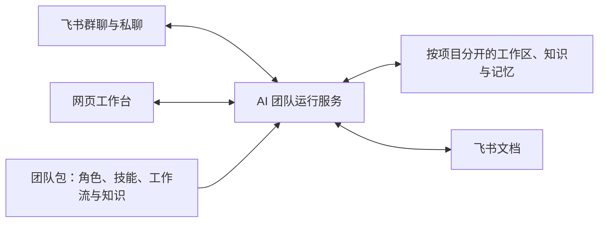
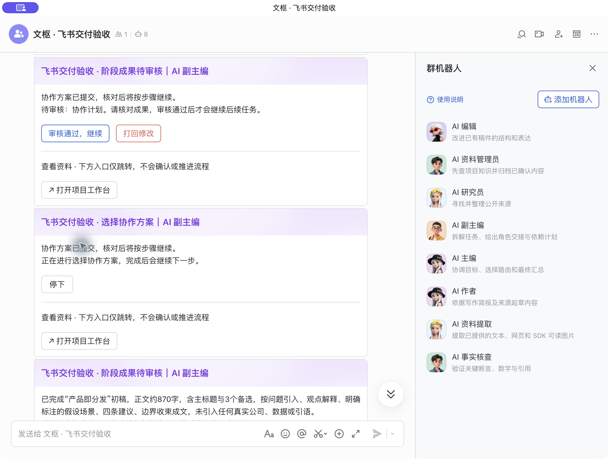
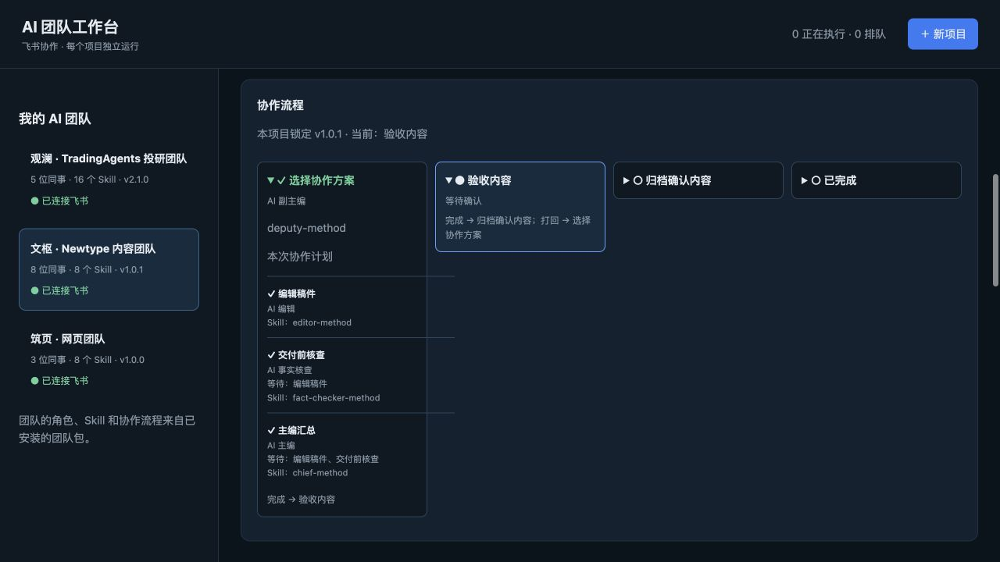
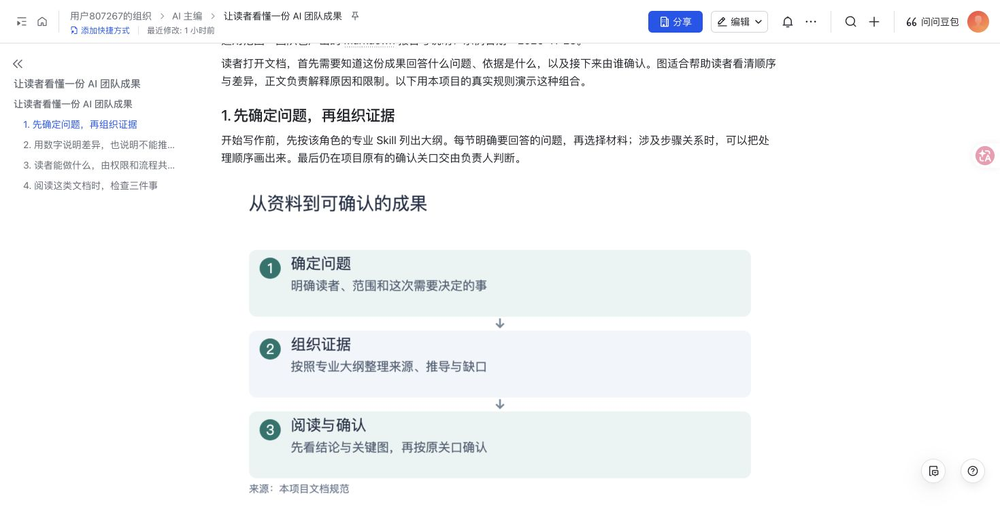

# 飞书 AI 团队

**在飞书里组建 AI 团队，用网页工作台管理项目，把团队的工作方法打包分享。**

你在飞书群里提需求，AI 同事按各自的角色和技能分工，沿工作流完成网页或完整应用开发、资料研究和内容生产。工作台同步展示每个项目的进度、每位同事正在做什么，以及已经交付的成果。

项目提供可运行的服务、网页工作台和 AI 团队包协议。你可以直接使用内置团队，也可以定义自己的 Agent、Skill、Workflow、Workspace 和 Wiki 知识，让别人安装后在自己的飞书组织里使用。

[实际界面](#实际界面) · [快速开始](#快速开始) · [知识与记忆](#知识与记忆) · [开放生态](#开放生态) · [开发与共建](#开发与共建) · [文档](#文档) · [提交问题](https://github.com/pengcong2020520/feishu-ai-team-starter/issues)


赛博朋克工作台首屏展示当前团队的项目看板，底部头像汇集每位同事的状态。悬停看任务，点击打开历史记录、角色提示词和 Skill；需要另一套工作方法时，从“团队生态”切换。

团队扫码连接完成后，身份卡通过斜向镜头转场汇入工作台。日常打开不重复播放，也可随时跳过。

## 你能用它做什么

| 能力 | 使用效果 |
| --- | --- |
| 在飞书里协作 | 与 AI 同事讨论需求、补充资料、提出修改，通过卡片确认下一步 |
| 管理多个项目 | 多项目模式下，每个项目独立建群，分别保存讨论、工作文件和角色会话 |
| 使用团队工作台 | 切换团队，查看角色、Skill、完整工作流、当前任务和交付文件；也能直接发起项目 |
| 查阅项目档案 | AI 提炼摘要和标签，先看最终成果，再追溯最初需求、关键决策与完整讨论 |
| 完成交付 | 最终 Markdown 经过独立质量检查，有问题时由原角色修正；专业 Skill 和既定流程继续保留 |
| 产出飞书文档 | 团队包的 Markdown 成果自动同步为文档，支持图表和图片；文档评论回流项目上下文 |
| 安装不同 AI 团队 | 同一套服务运行网页、投研、内容等团队，各自使用自己的角色与协作流程 |
| [私聊管理员助手](docs/管理员助手.md) | 复制或导入团队，修改角色、Skill、流程、模板和团队知识，试跑后应用新版、导出分享 |
| 保存业务知识与记忆 | 按需检索团队知识、项目决定和协作约定；更新保留旧版，连续对话可追溯 |

在已有飞书组织中，通过扫码连接机器人；本项目配套的网页工作台与飞书群共享同一份项目数据。



## 可用的 AI 团队

| 团队 | 角色分工 | 可以交付 |
| --- | --- | --- |
| **筑页 · 网页团队** | 产品经理、设计、程序员，3 位角色 | 从需求和 PRD，到线框、主题与可打开的静态网页 |
| **筑域 · 应用开发团队** | 产品经理、设计师、架构师、全栈程序员、测试部署工程师，5 位角色 | 规格、架构、前后端、SQLite 迁移、测试、本机发布与回滚 |
| **观澜 · 投研团队** | 研究主理人、公司研究、宏观策略、量化研究、风险分析，5 位角色 | 基于公开网页、PDF 和本地计算的研究报告 |
| **文枢 · 内容团队** | 主编、副主编、研究、核查、提取、写作、编辑、归档，8 位角色 | 从选题和资料，到文章、编辑稿与归档文档 |

例如，在网页团队群里说“做一个读书会报名页”，产品经理先整理需求，设计给出页面方案，程序员完成网页；你在飞书卡片中确认或提出修改，在工作台查看全过程。

观澜基于 [TradingAgents](https://github.com/TauricResearch/TradingAgents) 的研究方法适配，文枢基于 [Newtype](https://github.com/newtype-01/newtype-codex) 的内容协作方法适配。你也可以按同一协议制作行业团队。

筑域沿用团队包协议和按项目隔离的工作区，按 **Specify → Plan → Tasks → Implement → 架构复核 → 测试 → 本机发布 → 验收** 执行。Docker 在隔离环境运行 SQLite 迁移和 Node 测试，健康检查通过才展示应用入口；发布失败会恢复上一版。它是独立团队，安装后连接自己的五位机器人，已有筑页项目不会改变。见[安装与实测步骤](docs/完整应用团队方案.md)。

## 实际界面

以下为本地运行的文枢 1.0.1 示例项目与飞书客户端截图，拍摄于 2026-11-28。

**在飞书群里和整支团队协作。** 右侧是八位数字同事；左侧卡片汇报进展，需要你决定时提供操作按钮，带 ↗ 的入口用于打开资料或工作台。



<details>
<summary>查看项目工作流与飞书图文成果</summary>

**在工作台看任务如何衔接。** 展开步骤，可查看负责角色、使用的 Skill、前置任务和完成状态。



**在飞书文档里阅读成果。** 正文、章节目录和原生图片一起呈现，成员可在文档中评论，意见同步回项目。



</details>

**从成果回看整个项目。** 档案按 AI 提炼的标签分类，进入后先读最终文章或报告，再追溯每一步的讨论、补充和修改。进行中的项目也能查看，状态与实际流程一致。


飞书文档内容不变时不会重复追加正文；修改后产生独立版本，保留旧版与评论，卡片和工作台指向最新版本。

## 快速开始

准备 Node.js 24+、Git、可创建应用的飞书账号，以及支持工具调用和结构化输出的 Anthropic 兼容模型接口。服务可部署在本地 macOS / Linux 或 Linux 服务器。

### 让 Coding Agent 帮你搭建

把本仓库链接和下面这段话交给 Codex、Claude Code、Grok 等编程助手：

```text
请读取 AGENTS.md 和 docs/版本导航.md。
先确认我要搭启航版、领航版还是开放团队包，并选择部署在本地或服务器。
按对应搭建提示词配置模型、连接飞书、启动常驻服务。
再按 docs/工作台与成品复现.md 安装我选定的团队，启用赛博朋克工作台。
用一个真实项目检查角色状态、最终成品、飞书文档和项目档案。
需要业务知识与持续记忆时，继续执行 docs/prompts/knowledge.md：
通过管理员真实私聊验证知识新增、修订、旧版查询及连续追问，并检查两个项目不串内容。
已有配置和机器人请复用。
```

| 选择 | 适合什么需求 | 搭建提示词 |
| --- | --- | --- |
| 启航版 | 先在一个群里体验三位同事做网页 | [启航版](docs/prompts/basic.md) |
| 领航版 | 同时推进多个网页项目，每个项目独立群和上下文 | [领航版](docs/prompts/projects.md) |
| 开放团队包 | 使用完整应用、投研、内容团队，或安装自定义团队 | [开放团队包](docs/prompts/ecosystem.md) |

助手会带你配置模型、用飞书手机版扫码，并在所选机器上启动服务。标准团队包可选择人工确认或自动审核。

### 从源码启动

```bash
git clone https://github.com/pengcong2020520/feishu-ai-team-starter.git
cd feishu-ai-team-starter
node setup.mjs
```

`setup` 自动安装依赖，并输出当前需要完成的“下一步”。按提示选择部署位置、模型和机器人。完整步骤见[图文安装指南](docs/图文安装与权限指南.md)。

setup 完成基础服务后，按[工作台与成品复现](docs/工作台与成品复现.md)安装所选团队。**安装团队包后才会显示上图的赛博朋克工作台**；只用网页团队可仅安装筑页，无需安装其他团队。

打开 setup 打印的工作台地址，默认是 `http://127.0.0.1:4870`。日常用 `npm start` 启动、`npm stop` 停止、`npm run status` 查看服务状态。首次安装没有历史项目，向协调角色提出需求后，工作台会逐步记录讨论和成果。

## 知识与记忆

团队可以带着业务知识安装；管理员在飞书私聊中维护，角色按当前问题查相关页面。

| 内容 | 例子 | 使用范围 |
| --- | --- | --- |
| 团队知识 | 产品术语、研究方法、编辑规范 | 随团队包版本分享，项目读取自己锁定的版本 |
| 项目知识 | 本项目目标、截止时间、已定方案 | 仅当前项目 |
| 协作记忆 | 项目待办、协作约定、管理员个人偏好 | 项目约定限本项目；个人偏好仅管理员私聊使用 |

例如，私聊管理员：

> 从我选定的团队复制个人草稿“门店内容团队”，加入读者约定：面向小店经营者，不超过700字。来源是这条消息。保存后查给我看，暂不应用。

再发：

> 把刚才的上限改成900字，其他不变。保留旧版，告诉我原来和现在分别是多少。

管理员接续原对话，知识更新保留来源和旧版。长上下文先保留可检索原文，再整理；输入、缓存和输出分别统计，整理本身也计入消耗。项目知识和个人记忆不自动进入分享包。

这是服务内的 Wiki，不需要额外向量数据库或飞书知识库权限。开始使用见 [Wiki 搭建提示词](docs/prompts/knowledge.md)，字段和私聊用法见 [Wiki 知识层](docs/Wiki知识层.md)。

## 开放生态

**团队包保存一整套协作方式。** 它把角色、技能、调度关系、项目工作区和可分享的业务知识一起交给运行平台。

| 组成 | 定义什么 | 对应文件 |
| --- | --- | --- |
| Agent | 每个角色的职责、提示词，以及可调用的技能 | `agents/*.md`、`manifest.json` |
| Skill | 某项任务的做法、输入和输出 | `skills/*/SKILL.md` |
| 协作规则与 Workflow | 谁分派任务、谁接手、哪些任务并行、哪里需要确认 | `collaboration/SKILL.md`、`collaboration/workflow.json` |
| Workspace 与成果 | 项目目录、模板和需要交付的文件 | `manifest.json`、可选的 `workspace/` |
| Wiki 知识 | 业务知识页面、摘要、标签、来源和关联页面 | `manifest.json` 的 `knowledge`、`knowledge/*.md` |

你定义团队的工作方法，平台负责飞书接入、Agent 调度、项目上下文和工作台展示。新增团队通常只需编写团队包，不需要修改平台源码。协议见 [AI 团队包标准](docs/AI团队包规范.md)。

### 安装团队

可以仅安装需要的团队（[选择与命令](docs/工作台与成品复现.md#2-装入需要的团队)），也可以装入三支初始团队的定义：

```bash
node scripts/team-pack.mjs init
```

在工作台选择团队，点“扫码连接飞书”，完成角色连接后新建项目。当前团队已经创建的机器人会复用。

拿到别人分享的团队包后，运行：

```bash
node scripts/team-pack.mjs install ./my-team.team.json
```

安装命令也接受本地包目录，或包含完整 40 位提交号的 GitHub 包目录链接。团队作者可以通过自己的 GitHub 仓库或 `.team.json` 文件分享；使用者安装后配置模型和飞书机器人即可使用。

## 开发与共建

你可以从三处参与：

- **制作团队包**：把你调试好的业务流程、Agent 和 Skill 组合成可安装的团队，例如运营周报、客户研究或课程制作。
- **贡献角色与技能**：改进现有角色提示词、任务方法和文档模板，或将开源方法适配为团队包。
- **开发平台能力**：扩展工具接入、飞书交互、工作流编排和网页工作台。

制作第一支团队，从[两角色示例](examples/team-package/)开始：

```bash
cp -R examples/team-package team-packages/my-team
```

修改 `manifest.json` 的团队信息，编写角色、技能和协作流程，再校验并导出：

```bash
node scripts/team-pack.mjs validate team-packages/my-team
node scripts/team-pack.mjs export team-packages/my-team /tmp/my-team.team.json
```

也可以把 [team-packager Skill](skills/team-packager/SKILL.md) 交给 Coding Agent，让它整理、打包你在本地调试好的团队。

分享新团队可[提交 Issue](https://github.com/pengcong2020520/feishu-ai-team-starter/issues/new)，附上包链接、用途和示例成果；贡献代码或文档请提交 PR。目录说明、运行命令和提交方式见 [CONTRIBUTING.md](CONTRIBUTING.md)。

## 文档

| 想了解什么 | 入口 |
| --- | --- |
| 安装、扫码和配置 | [图文安装指南](docs/图文安装与权限指南.md) · [版本导航](docs/版本导航.md) |
| 复现新版界面与交付流程 | [工作台、项目档案与成品复现](docs/工作台与成品复现.md) |
| 本地常驻或服务器部署 | [部署说明](docs/部署与常驻.md) |
| 创建和分享 AI 团队 | [团队包标准](docs/AI团队包规范.md) · [打包 Skill](skills/team-packager/SKILL.md) |
| 团队知识、项目知识与连续记忆 | [Wiki 使用与协议](docs/Wiki知识层.md) · [搭建提示词](docs/prompts/knowledge.md) |
| 飞书文档与图文成果 | [文档同步](docs/飞书文档同步与反馈.md) · [图文示例](docs/examples/图文文档示例.md) |
| 修改代码与参与贡献 | [贡献指南](CONTRIBUTING.md) · [模块结构](docs/施工图.md) · [编程助手说明](AGENTS.md) |

## 许可证与来源

平台代码使用 [MIT](LICENSE)。筑页部分技能来自 spec-kit 与 Anthropic Skills；观澜保留 TradingAgents 的 Apache-2.0 许可；文枢单独下载并保留 Newtype 的 SUL-1.0 来源声明。第三方内容按各自许可证使用，详见 [THIRD_PARTY_NOTICES.md](THIRD_PARTY_NOTICES.md)。
