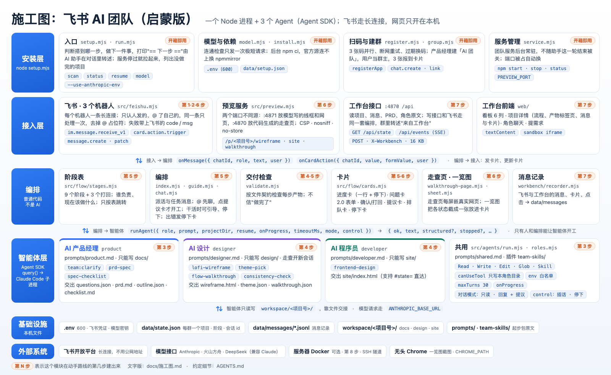

# 飞书 AI 团队 · 起步包

用 [Claude Agent SDK](https://code.claude.com/docs/en/agent-sdk/overview) 搭一支飞书 AI 团队：AI 产品经理、AI 设计、AI 程序员 3 个同事在飞书群里协作，把一句话需求做成一个能用的网页；另有一个网页工作台，一屏看清所有项目。

仓库里是能直接运行的完整代码。你不用自己敲命令：让 AI 编程助手（Claude Code、Codex、Grok 等，桌面版或终端版都行）带着你装。



## 先选一个适合你的版本

把本仓库链接交给 coding agent，它应先问你想搭哪一种。只想先跑通一个网页项目，选**启航版**；需要多个项目独立协作，选**领航版**。两版都使用 `main` 的完整代码，均包含三个 AI 同事、管理员助手和工作台。

| 版本 | 适合什么情况 | 项目与群 | 人员分工 | 搭建提示词 |
| --- | --- | --- | --- | --- |
| **启航版 · 单群入门** | 个人体验、小团队先跑通 | 在原群按顺序做项目，不自动另建项目群 | 无需设置人员名册 | [启航版](docs/prompts/basic.md) |
| **领航版 · 多项目协作** | 多个项目同时推进、不同人负责确认 | 每项目独立群、工作区和角色会话 | 岗位＋负责范围＋确认事项 | [领航版](docs/prompts/projects.md) |

所有版本和提示词的固定入口是[版本导航](docs/版本导航.md)。以后新版本在这里追加，现有提示词保留。`learn` 分支另供历史编程学习，不是安装版本。

## 安装别人设计好的 AI 团队

现在也可以把一整支团队作为包安装：角色提示词、每个角色的 Skill、协作规则、人员确认关口、工作区和交付标准一起复现。平台版本与团队包分开，原来的启航版、领航版提示词继续保留。

初始提供 **筑页 · 网页团队**、**观澜 · 投研团队**、**文枢 · Newtype 内容团队**。Newtype 使用上游固定提交的八角色方法，按目标选择研究、写作、编辑等任务；采用独立下载适配，保留 SUL-1.0 来源与许可说明，不属于本仓库的 MIT 内容。

完成原本的本机安装后运行：

```bash
node scripts/team-pack.mjs init
```

然后从工作台顶部进入“团队与项目”（默认 [本机入口](http://127.0.0.1:4870/teams)），选择团队、项目目标和确认人。可先在本机完成项目；创建飞书独立群使用领航版，复用或补扫团队所需机器人。不同角色数、不同交付文件都由包定义，项目锁定精确包版本与内容摘要。

- 搭建者：[开放团队包提示词](docs/prompts/ecosystem.md)、[AI 团队包标准与安装命令](docs/AI团队包规范.md)。
- 创作者：把 [team-packager Skill](skills/team-packager/SKILL.md) 交给 Coding Agent，整理本地已调试团队并实际完成校验、导出和干净目录重新安装；[两角色完整示例](examples/team-package/) 可直接复制改造。
- 已有包：`node scripts/team-pack.mjs install <包目录或.team.json文件>`；也接受包含 40 位提交号的 GitHub 包目录链接。安装不执行来源中的脚本或全局配置修改。
- 实时搜索需要可选的 `BRAVE_SEARCH_API_KEY`；没有搜索配置时可提供公开 HTTPS 来源。网页读取已提供，PDF、音视频请先给出提取文本；不能把模型记忆说成已联网检索。

第三方包无需改平台源码。旧网页项目沿用原编排；标准包的人工关口、依赖、并行和文件权限由通用编排执行，未完成的任务可停下和重试。实际验证范围见 [团队包验收](docs/团队包验收.md)。

## 怎么用

1. 克隆到一个新目录：

   ```
   git clone https://github.com/pengcong2020520/feishu-ai-team-starter.git my-feishu-team
   ```

2. 在这个目录里打开 AI 编程助手（Codex 请先切到能联网、能运行命令的模式），说：

   ```
   先读 AGENTS.md 和 docs/版本导航.md，问我想搭什么样的团队，
   再按对应版本的提示词帮我在本机搭起来。已有机器人请复用。
   ```

3. 助手会在对话里一步步问你、带你做。你只需要：
   - 回答模型的接口地址、密钥、模型名（Anthropic 兼容接口，比如火山方舟的 `https://ark.cn-beijing.volces.com/api/compatible`；终端里已经配好 `ANTHROPIC_*` 变量的，说"沿用"即可）；
   - 用飞书手机版扫 4 个二维码，在手机上确认创建 3 个 AI 同事和 1 个 AI 管理员助手（只在私聊里帮你照看团队，扫它的人就是管理员）；
   - **启航版**：在自动建好的「AI 团队」群里 @AI 产品经理提需求，点“就按这个开始”后在原群开工。
   - **领航版**：先在工作台“人员与职责”导入真人、设置本机操作者和职责，再提需求；产品经理为新项目另建群，复用三位 AI 同事，邀请匹配的成员。

之后均按同一流程推进：**澄清 → 确认 PRD → 线框与主题 → 确认设计 → 开发 → 自动走查 → 验收**。想改哪里就 @ 对应同事；干活时说的话会先记下，急的话点“现在引导”，说“停止”就停下。工作台“提需求”是明确开工操作，提交后直接进入澄清。

当前版本可用 `node setup.mjs status` 查看；启航版配置为 `TEAM_MODE=basic`，领航版为 `TEAM_MODE=projects`。按对应提示词选择，其他安装、真实需求和调试步骤见[复现指南](docs/复现指南.md)。

飞书里私聊「AI 管理员助手」，发“状态”能看团队现状。项目停下时点“接着做”；团队服务停了时点“重启团队服务”。其他事直接跟它说：问项目进展、让同事重试或修改、改角色说明和技能、小改代码都行。改代码要在卡片上点“上线”才生效；生效之后可以点“撤销这次改动”，也可以私聊发“撤销”。

管理员助手能处理哪些事：

让管理员代点关口时，用明确短指令，例如“确认 #3 设计”“打回 #3 网页”“验收通过 #3”。一条指令只用于一次代点；查看、条件句、否定句和旧指令都不授权确认。

| 私聊任务 | 处理方式 |
|---|---|
| 项目停下、网页有 Bug | 查状态和日志；按你的要求恢复项目、打回网页并把修改意见交给同事，改完再走查验收 |
| 调整角色说明、已有 Skill 内容 | 在工作副本修改，完整测试通过后生效；同事下次干活读取，不用重启 |
| 新增 Skill 并绑定角色、修改允许范围内的业务代码 | 涉及角色表或代码时，整次改动先等你签字，再测试、上线、重启并检查健康状态 |
| 模型地址或密钥、部署配置、编排阶段表、管理员自身代码 | 交给搭建项目的编程助手处理，不在私聊管家的修改权限内 |

它负责这套团队和产物的日常维护，不能管理任意外部线上系统。一次只处理一件事，改动保留在运行机器的 Git 中，不自动推送 GitHub。真实项目与管理员能力的验证范围见[管理员助手验收](docs/管理员助手验收.md)。

准备：Node.js 24 以上、Git；能创建飞书应用的账号（自建团队的管理员最省事）；支持 Anthropic 消息、工具调用与结构化输出的模型接口。安装脚本的连通检查不等于 Agent 全流程通过，搭好后请按[复现指南](docs/复现指南.md)跑一个真实需求。

工作台和预览地址以 setup 最后打印的地址为准：默认端口为 4870/4871，被占用会自动调整，容器默认宿主端口是 4880/4881。Chrome/Chromium 用来生成卡片一览图；没有浏览器时链接仍可用，但没有截图。

团队服务跑在你的电脑上：合盖睡眠时群里的 AI 同事收不到消息（点卡片会提示"目标回调服务不在线"），打开后会自己连回来；电脑重启后，对助手说"飞书没反应了"，它会把服务拉起来，并问你要不要接着做没做完的那一步。

## 领航版的多项目与人员职责

每个新项目单独建飞书群，三位 AI 同事复用同一套 SDK；项目工作区、讨论和角色会话分别保存。同一群内按顺序回复点名，跨群可并行；跨项目共用角色说明与技能，不自动共享项目原文或学习公共记忆。

在工作台“人员与职责”从已有群导入真人，为每人添加多条“岗位＋负责范围＋确认事项”。例如小林是“产品／APP／需求澄清、需求确认”，小周是“设计／APP／设计确认”，小陈是“开发／Agent／最终验收”。新项目填 `APP` 或 `Agent` 范围，就能匹配相应成员；范围按文字匹配，多人负责同一关口时需显式选择。

群内所有启用的真人都可讨论，确认、打回和修改意见由指定确认人提交，结束项目由负责人提交。管理员代点也遵守分工。改名册影响后续分配；既有项目要在详情“人员分工”中调整。移出项目分工不会自动踢出群。

已有机器人运行 `node setup.mjs upgrade-projects`，给原产品经理扫码增补权限；无需重建，等当前步骤完成后重启。新项目也可选“本机项目”，但它不证明飞书建群与邀请已成功。整套服务默认最多同时执行 **3 个**模型任务（含管理员和只读聊天），其余排队，不是每位同事各 3 个。新群结束后保留为项目档案，新需求从入口群、产品经理私聊或工作台进入。

两项目并行、上下文隔离和分工的可复制步骤见[领航版提示词](docs/prompts/projects.md)，实际验证结果和未覆盖项见[多项目验收](docs/多项目验收.md)。

## 想改点什么

直接对助手说，比如"让 AI 设计更偏好深色主题""给产品经理加一条：PRD 里必须写验收标准"。角色说明在 `prompts/`，技能在 `team-skills/`，助手照 [AGENTS.md](AGENTS.md)「改角色和技能」去改。

## 仓库里有什么

| 内容 | 是什么 |
|---|---|
| `setup.mjs`、`src/setup/` | 一条命令搭好：模型、扫码建 3 个 AI 同事和管理员助手、自动建群、后台启动服务 |
| `src/`、`web/` | 团队服务（接入飞书、编排、3 个 Agent、预览与工作台）和工作台前端 |
| [prompts/](prompts/) | 4 份角色说明：共用约定、产品经理、设计、程序员 |
| [team-skills/](team-skills/) | 技能插件 `team`：8 个技能（澄清、PRD、需求自查、线框、主题、走查、需求覆盖检查、前端） |
| [AGENTS.md](AGENTS.md) | 项目说明书：怎么装、怎么改、整体结构、接口与文件格式、踩过的坑。Codex 自动读；[CLAUDE.md](CLAUDE.md) 让 Claude Code 也读同一份 |
| [版本导航](docs/版本导航.md)、[搭建提示词](docs/prompts/) | 启航版、领航版的选择、安装、升级和验收，各自独立保留 |
| [docs/施工图.md](docs/施工图.md) | 每一层有哪些模块、放在哪个文件、负责什么、怎么相连 |
| [docs/实测复盘.md](docs/实测复盘.md) | 实测记录：每步用时、人做什么、做出来什么样、踩过的坑 |
| [docs/动手搭建.md](docs/动手搭建.md) | 从零自己搭的路线（配合 `learn` 分支） |

## 想从零自己搭

`learn` 分支是较早的三同事版本，只有说明书、角色和技能，没有代码。它适合配合[历史动手路线](docs/动手搭建.md)理解原理，尚不包含当前管理员助手等后续能力。要复现当前发行版，请使用上面的 `main` 安装步骤；不要把学习分支当成最新版：

```
git clone -b learn https://github.com/pengcong2020520/feishu-ai-team-starter.git my-feishu-team
```

## 这是启蒙版

为了讲清楚原理，每个项目仍只交付单文件静态网页，单机运行、状态保存在本机文件里；多个项目可在总并发上限内同时推进。后续可以加角色、让 Agent 看到页面、接模型网关和 MCP 工具、工作台上公网……起步提示词都在动手路线的最后。

## 出处与许可证

本仓库以 MIT 许可证发布。部分技能改编自 [github/spec-kit](https://github.com/github/spec-kit)（MIT）和 [anthropics/skills](https://github.com/anthropics/skills)（Apache-2.0），见 [THIRD_PARTY_NOTICES.md](THIRD_PARTY_NOTICES.md) 和各技能文件开头的说明。
