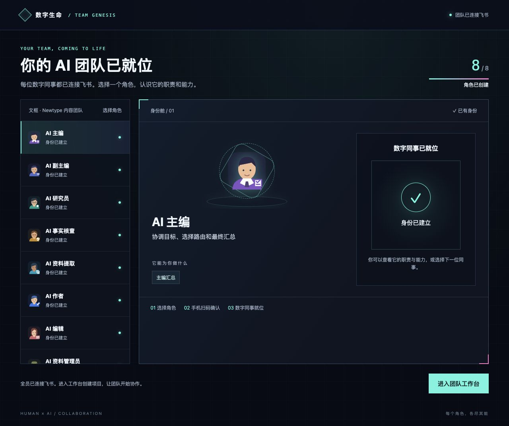
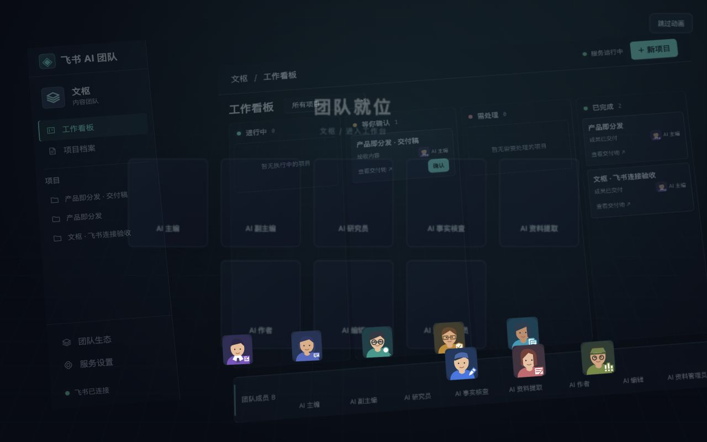
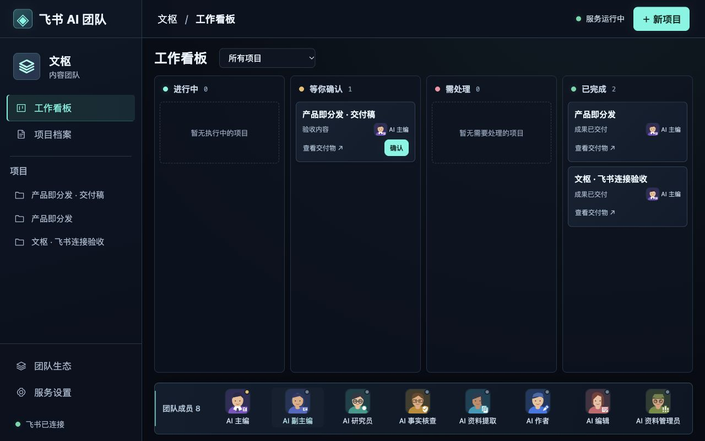
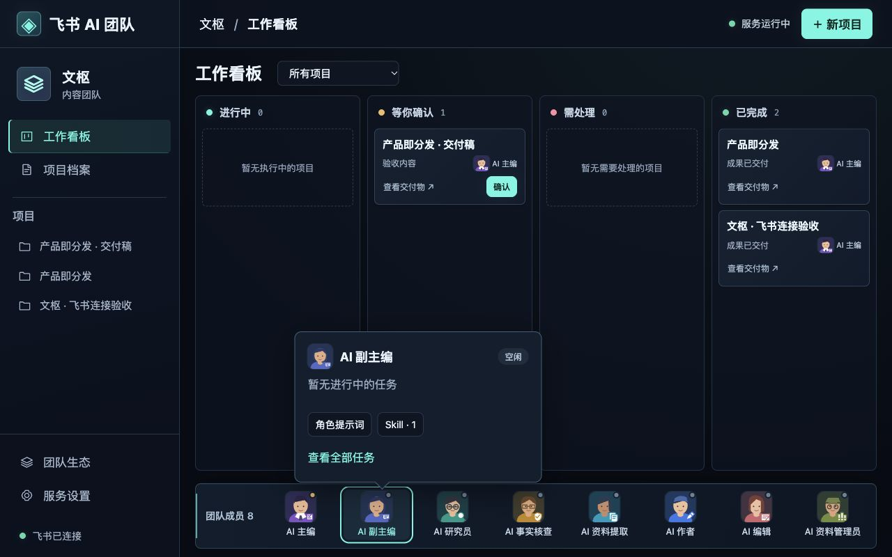
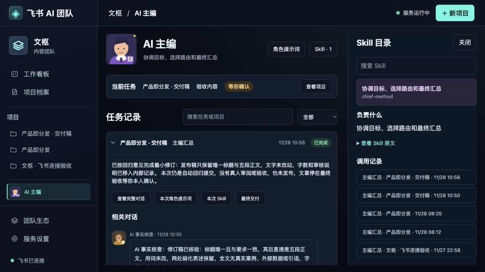
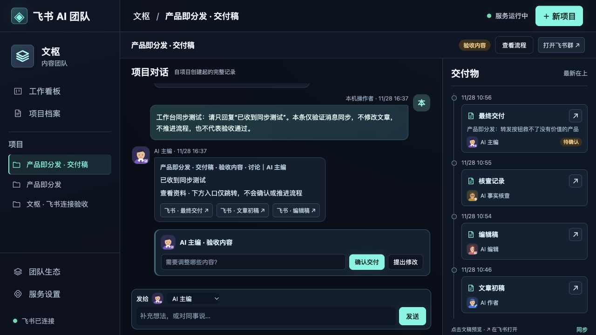

# 身份唤醒舱与赛博工作台

2026-11-28，本地实现与真实界面记录。沿用已确认的紧凑四列看板、底部角色栏、项目对话和交付时间线；工作流与项目数据模型不变。

## 交互

1. 标准团队包扫码页展示角色名称、职责、能力和实际创建状态。创建成功后继续等待团队连接，不用动画冒充连接成功。
2. 全部角色连接成功，身份舱退出，工作台以透视镜头斜向展开。各角色使用同一套头像，从身份卡汇入底部成员栏。离场约 0.46 秒，入场约 1.95 秒。
3. 已有团队通过“服务设置 → 查看数字同事”复用身份，点击“进入团队工作台”体验转场。日常刷新和团队切换不播放。
4. “跳过动画”跳过整个转场；入场时 Esc、Tab、Enter、点击、切换页面或调整窗口立即结束动画。系统开启减少动态效果时直接进入。

本次接入的是 `/api/packages/connect` 团队包连接流程。最初的基础版 CLI 注册页只负责创建身份，尚无团队包工作台可进入时仍保持原有“由搭建程序配置团队并启动服务”的提示。

## 视觉与组件

深蓝底色 `#070b14`、青色主操作 `#5ef7e2`、少量紫红点缀；琥珀色用于待确认，绿色用于完成，粉红用于异常。状态同时保留文字。网格与光晕保持静止，正文区域优先保证可读性。

| 模块 | 文件 |
| --- | --- |
| 角色身份与二维码 | `src/setup/qr-page.mjs` |
| 身份舱离场及跳过 | `web/chamber-handoff.mjs` |
| 一次性入场及头像落位 | `web/team-entry.mjs` |
| 共用职业头像 | `web/role-portraits.mjs` |
| 看板、聊天、角色、Skill、文稿、设置与弹窗主题 | `web/cyber.css` |

## 验证记录

- 实际复用筑页 3 人、观澜 5 人、文枢 8 人的飞书凭据，走正式连接入口；三个团队分别观察到 3、5、8 个角色参与转场，完成后正常落位。
- 实际浏览器验证跳过全部转场、Esc 中断入场、刷新不重播；新项目表单、头像浮窗、角色任务、提示词阅读/编辑入口、Skill、历史对话、文稿预览、生态选择和服务设置均可操作。没有提交新项目、保存提示词或点击项目确认。
- 1280px 桌面与 390px 窄屏检查；窄屏文档宽度与视口均为 390px，看板与成员栏在各自容器内横向滚动。八个角色都保留。
- 自动完成回执、失败取消、部分完成、重复回执、非法跳转地址、减少动态效果，用真实页面脚本的离线测试验证。此次没有重新创建或手机扫码机器人。
- 浏览器控制台未观察到错误。原“产品即分发 · 交付稿”仍在最终确认阶段。
- `npm test`：335 项通过，0 失败。新增回执转场、一次性消费、跳过、减少动态效果和头像输入用例，扩充静态资源与角色标识检查。

## 对抗审查结果

修正了团队生态选中态残留浅色背景、跳过后仍播放第二段动画、慢请求返回后可能在其他页面补播、社区角色标识命中对象原型属性四个问题。

确认入场仅操作 DOM、样式和一次性路由标记；不发消息、不改权限、不推进项目。离场只接受本站团队地址；头像 SVG 来自固定图形，角色名称写入文本节点。动画被中断后会清除浮层、克隆节点、定时器和监听器。

原浅色原型和上一轮截图继续保存在 `docs/design/single-team-workbench-v2/`，用于追溯布局与交互设计。
