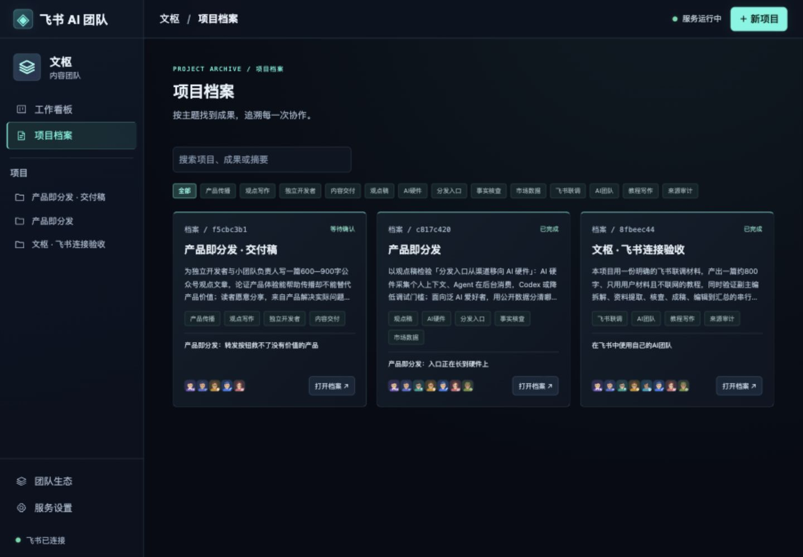
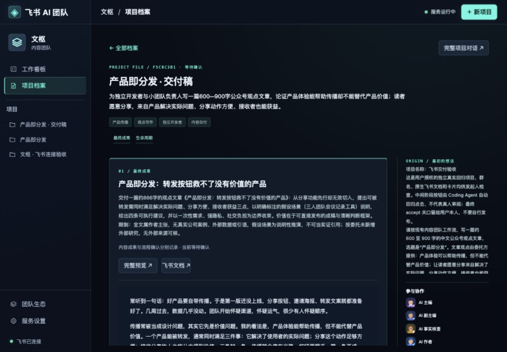
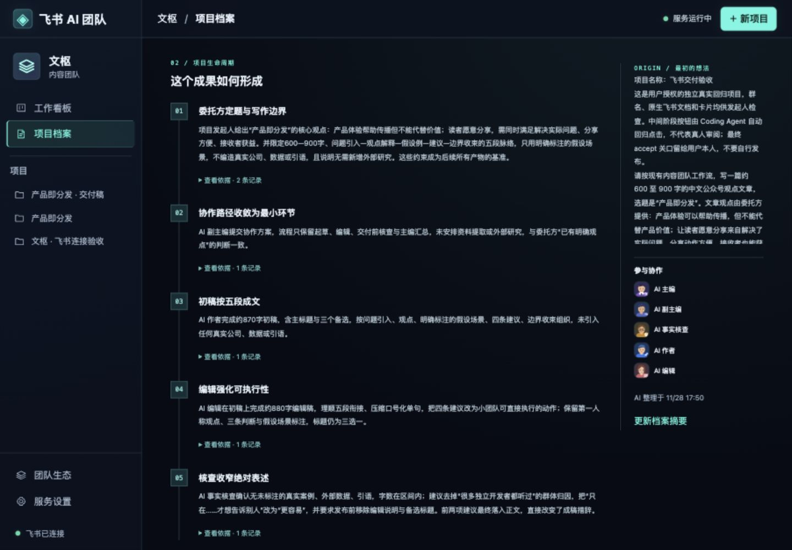

# 项目档案与成品交付

2026-11-28，本地实现。沿用现有赛博朋克工作台和各团队 workflow。

用户希望项目档案呈现从个人想法、AI 协作、真人补充到最终成品的完整生命周期，而不是一个聊天记录入口或过程文件列表。成品应能直接阅读和使用，不把编辑、整合或填空工作留给用户。

## 页面

- 项目卡：AI 摘要、自动主题标签、实际成果标题、参与角色、真实状态。包含进行中的档案；点击标签筛选，搜索项目、摘要和成果。
- 项目档案：先展示最终成果与飞书入口，再展示 AI 整理的生命周期节点。正文只呈现一次，旧稿进入修订记录。
- 每个关键节点引用实际讨论、任务或决策，展开可看原话并定位完整项目对话。完整记录独立保留，不用 AI 摘要替代。
- 旧网页项目通过只读档案投影接入，不改存储或接管旧编排；共用旧群的项目按时间隔离消息，无群号的本机网页也可查看成果。
- 窄屏改为单列；头像和文档跳转入口保留。原有确认、对话、角色详情、提示词和 Skill 页面继续使用。

## 成品与流程

最终成果由工作流的最终确认节点反查，网页团队使用实际网页文件，不把最后写出的归档说明当成果。最终 Markdown 交付除文件契约外，增加重复段落、标题与占位检查，以及独立只读内容检查；发现问题由原角色按原 Skill 修正，最多两轮。用户仍决定正式确认和对外发布，内容检查不能伪造批准。

同步改为独立正文版本：正文和配图未变时只更新状态；内容改变时生成新版本，旧文档顶部链接最新正文，旧正文、人工编辑和评论保留。新旧评论都回流到本项目。

档案 AI 使用隔离只读会话，按真实证据提炼标签、摘要和关键节点。结果缓存，记录或文件变化后更新，不在三秒轮询中反复调用模型。超大记录超过单次整理上限时显示原因，完整原始记录仍可查看。

## 本地验证

- 现有五个项目生成了真实模型档案；文枢与观澜的正文同步均完成，没有文档或评论接口错误。
- 《产品即分发：转发按钮救不了没有价值的产品》旧文档有三个一级标题，混合旧汇总与重复文章；修复后的文档回读为一个标题、五段正文。历史文档增加最新入口。
- 同一篇文章经真实模型实际读取正文、讨论与修改记录，检查通过；原 `accept` 状态保留，没有代替用户确认。
- 浏览器验证了标签筛选、搜索、成品预览、生命周期依据展开、完整记录展开和返回导航；480 px 窄屏无横向溢出。
- 完整离线回归 344 项通过；新增缺少群号的旧项目读取也通过专项回归。
- 对抗检查覆盖跨项目记录混入、伪造档案引用、缺失 Read 回执、检查期间文件变化、自动修正上限、旧评论丢失、状态更新重复写正文、异步详情返回污染当前页面。
