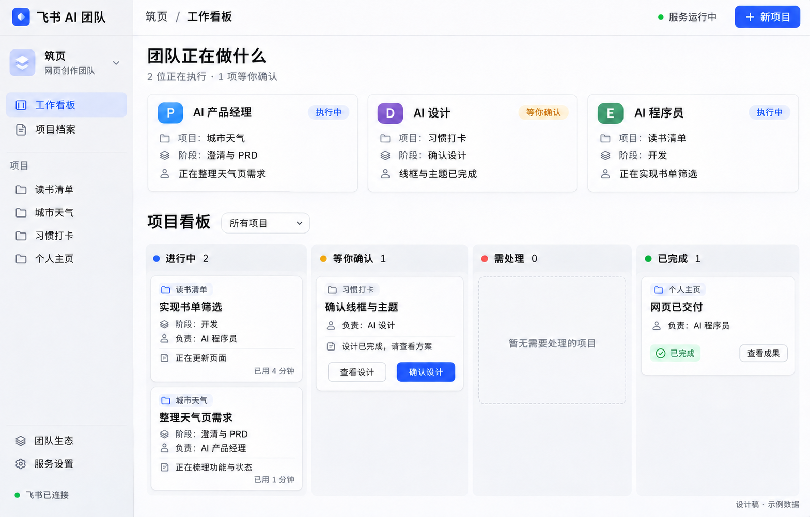
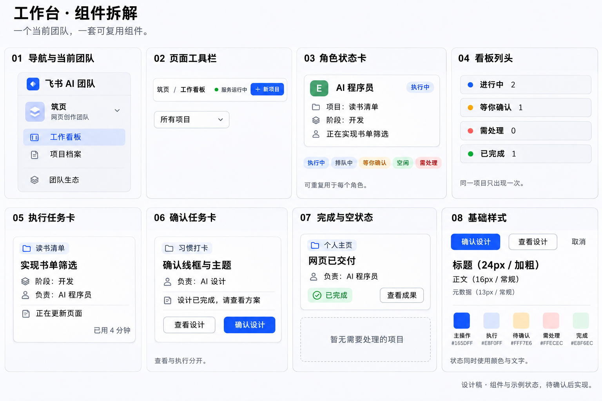

# 单团队工作台 · 原型 V1

2026-11-28 · 用户已确认原型与组件拆解，前端已按此实施。本目录保留原始设计与示例数据，实际界面读取运行服务。

参考 [Multica 官方工作台](https://multica.ai/) 的窄侧栏、状态分列和紧凑任务卡，适配本项目的飞书协作与既有 workflow。图片通过内置 imagegen 绘制并检查，项目名称、活动及数量均为设计示例，不代表服务当前运行状态。

## 完整原型

- 工作台聚焦一个当前团队。筑页、观澜、文枢是生态中的可选团队包，不在首页并列展示。
- 顶部角色卡回答三个问题：属于哪个项目、处于哪个阶段、现在在做什么。Skill 与角色说明进入角色详情。
- 项目卡按“进行中、等你确认、需处理、已完成”分类；同一项目只出现一次。这是状态视图，不替换原 workflow 的阶段与转移规则。
- 查看成果使用次按钮，确认推进使用主按钮。点击任务打开项目详情，保留讨论、产物和现有动作。
- 团队生态入口用于选择另一套成熟团队；切换当前视图不改写旧项目的包版本、上下文或工作流。

## 组件划分

| 编号 | 组件 | 数据和交互 |
| --- | --- | --- |
| 01 | 导航与当前团队 | 当前包名称；项目导航；团队生态入口；服务设置 |
| 02 | 页面工具栏 | 当前团队、真实服务状态、新项目入口及项目筛选 |
| 03 | 角色状态卡 | 角色、项目、阶段、当前活动；区分执行、排队、等人确认、空闲和需处理；点开查看任务与 Skill |
| 04 | 看板列头 | 按当前团队及筛选范围统计项目；列名不修改 workflow |
| 05 | 执行任务卡 | 项目短名、当前任务、阶段、负责角色、活动与有依据的耗时 |
| 06 | 确认任务卡 | 待确认的成果、查看入口、当前有效的确认动作；使用既有权限与卡片校验 |
| 07 | 完成与空状态 | 交付入口；没有项目时明确显示空状态，不造假活动 |
| 08 | 基础样式 | 主次按钮、状态标签、字阶、间距、边框、角色头像 |

## 还原时的约定

- 以这两张图为视觉基准实现；真实页面中的项目名称、数量、活动与空闲状态来自服务，不复制示例项目。
- 当前绘制的是三角色示例。五角色和八角色沿用同一组件按网格换行，每个角色可见，不固定写死三个角色。
- 同一角色承担多个项目时显示任务数量，展开列出各项目的阶段与活动，不用单个状态覆盖其他任务。
- 排队不算正在执行；等待人工确认不算模型占用；历史完成记录不冒充正在工作。展示实时数据时保留这些区别。
- 筛选、刷新、查看详情不应丢失讨论草稿或跳回其他项目。项目详情沿用当前流程动作，不通过拖卡跳过确认。
- 服务设置与团队生态为收敛入口，具体二级页面在实现时复用现有能力，图标不代表新增后台功能已完成。
- 参考画布为约 1568 × 1004；侧栏约 258，内容边距约 28。界面实际按可用宽度响应，视觉还原以原图为准。

绘图提示词见 [prompts.md](prompts.md)。
