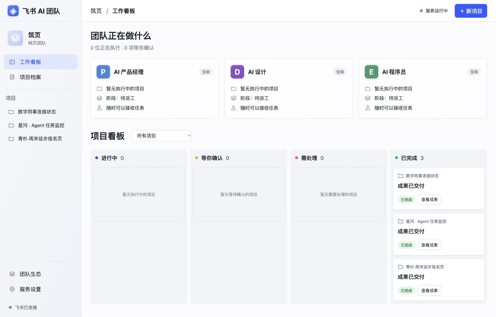
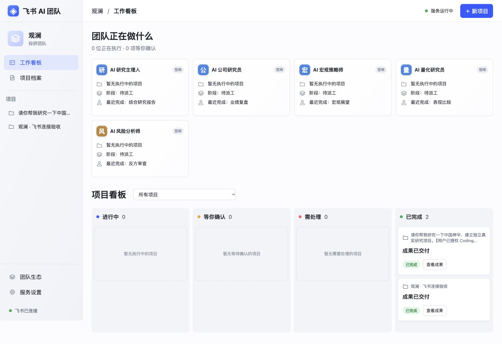
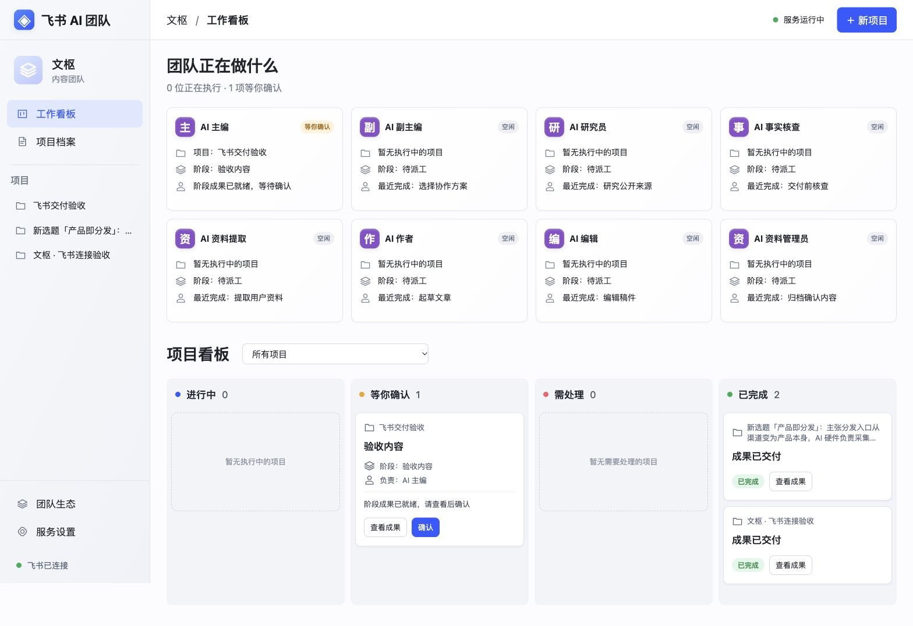

# 本地实现记录

2026-11-28，按用户确认的原型实施。入口为服务打印的工作台地址，默认 `http://127.0.0.1:4870/teams`。

## 页面

首页只显示当前团队。角色卡列出项目、阶段与活动，点开可看全部关联任务、项目和 Skill。三角色一排；五、八角色按网格换行；窄屏保留全部角色，项目列可横向滚动。团队生态入口切换已安装包，浏览器记住选择。旧项目深链接仍定位到所属团队，原网页项目继续打开 `/legacy`。

项目按“进行中、等你确认、需处理、已完成”分类。这些分类只用于展示，不修改团队包的 workflow。新项目固定使用当前团队，审批、修改、重试、停止和文档同步继续调用原有接口。

## 真实界面

截图直接来自本地服务，没有添加鼠标箭头或模拟活动。截图时所有模型任务已空闲，文枢有一个项目等待最终确认。

## 检查结果

- 实际浏览三、五、八角色页面，检查角色详情、Skill、项目详情、成果入口、团队切换与服务信息。
- 新项目表单绑定当前团队；测试中未提交新项目、发送讨论或点击真实确认按钮。
- 讨论草稿返回项目后保留；刷新和重新进入工作台后保留当前团队。
- 对照原型的 1568px 桌面宽度，以及 390px 窄屏检查；八角色全部展示，页面无水平溢出，浏览器无脚本错误。
- 离线测试覆盖跨项目多任务、多个角色并行、排队恢复、失败、人工确认、自动审核、群聊回复、旧项目与旧版本角色；本次 `npm test` 共 321 项全部通过。

## 对抗检查与修正

| 检查问题 | 处理 |
| --- | --- |
| 历史任务的 running 标记会不会让空闲角色看起来仍在执行？ | 必须同时满足项目忙碌、当前 running 角色和活动状态；结束项目只显示独立的实时讨论任务 |
| 排队拿到名额后是否一直显示排队？ | 区分 `onQueued(true)` 与 `onQueued(false)`，加入真实引擎回归 |
| 同一角色在两个项目中工作，会不会只留下一个项目？ | 保留全部任务，角色卡显示数量，详情逐项列出 |
| 自动审核、协调分派和群聊回复会不会遗漏？ | 增加只存内存的实时活动，结束即移除，不写回 workflow 状态 |
| 切换团队会不会把另一个团队的项目和上下文混进来？ | 按包 ID 筛选，项目锁定定义优先，旧网页项目只归入筑页 |
| 升级后的包删了角色，旧项目正在运行的角色会不会消失？ | 加入活跃旧项目的角色，项目中的角色/Skill 入口读取锁定版本 |
| 新建项目或确认是否改用了另一条执行路径？ | 沿用原创建接口与阶段、项目、卡片编号校验；看板不支持拖卡跳阶段 |

本轮验证的是工作台与状态展示，没有重新运行文章、投研或网页的模型生产流程。已有项目、文档、机器人及已确认成果保留。
