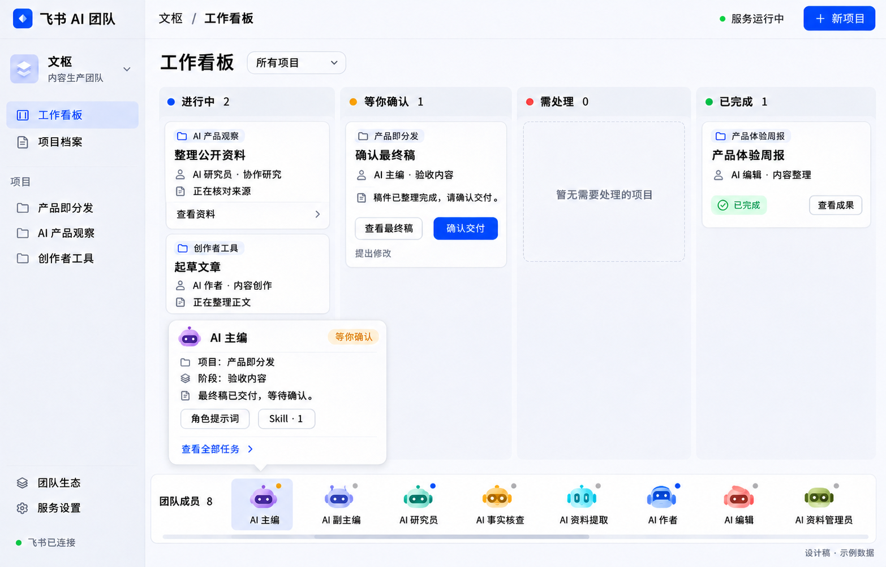
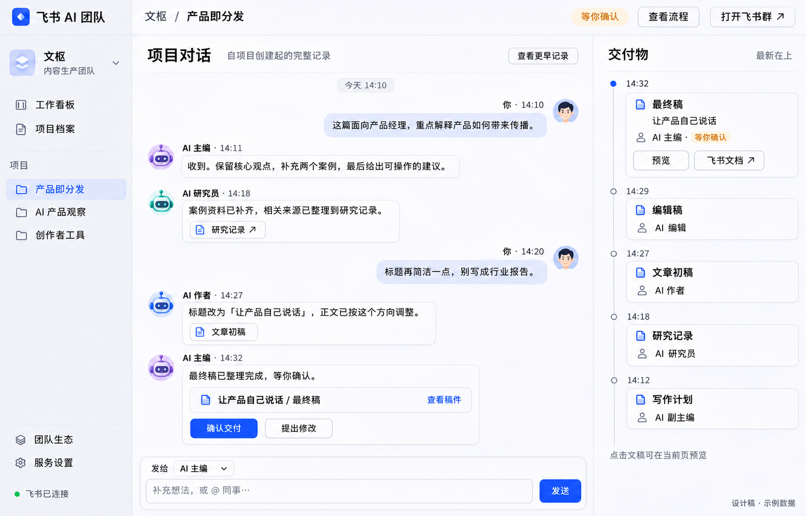
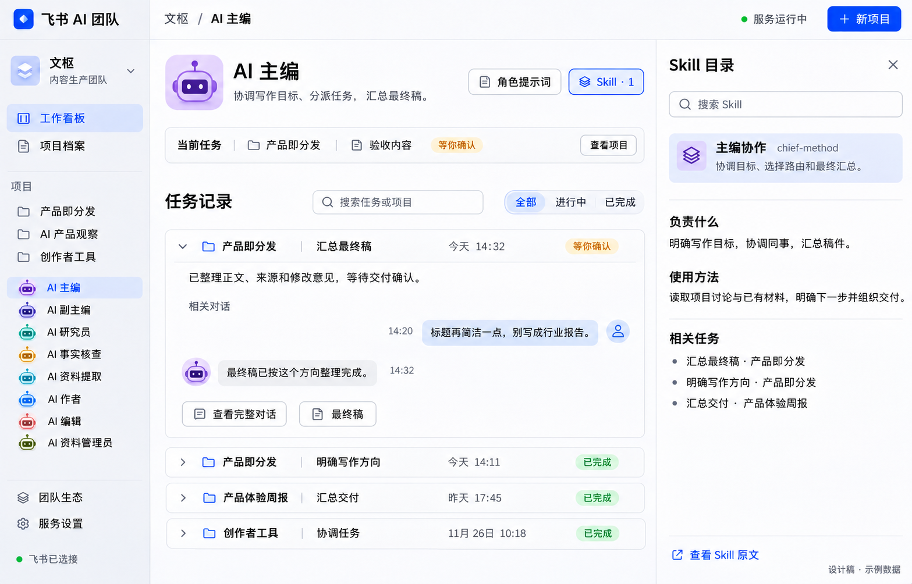
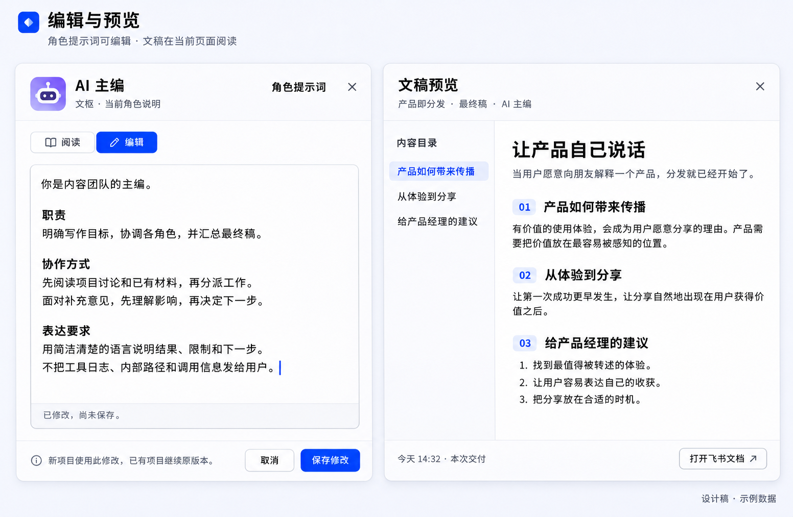

# 单团队工作台 · 原型 V2

2026-11-28 · 用户已确认，本地前端已按本稿实现。下列原型图片保留为设计基准，实际界面读取本地项目。图片使用内置 imagegen 绘制并逐张检查；项目、消息、时间和状态均为示例。

沿用 [V1](../single-team-workbench-v1/README.md) 的浅色、窄侧栏和四列看板，调整首屏布局、角色入口和项目阅读方式。

## 1. 首屏看板与头像浮窗

- 看板紧接工具栏，占据首屏主体。保留“进行中、等你确认、需处理、已完成”四列，列内独立滚动。
- 角色收成底部单排头像，名称始终可见；头像、名称和消息中的身份保持一致。三人、五人、八人均用相同规则，容器不足时左右滑动，不换行挤占看板。
- 头像状态点区分执行、排队、等人确认、需处理、空闲；浮窗同时用文字说明，不仅靠颜色判断。
- 鼠标悬停或键盘聚焦头像，在头像上方显示聊天式浮窗。浮窗内显示项目、阶段、当前活动，提供“角色提示词”“Skill”“查看全部任务”。没有遮罩，鼠标可移入浮窗操作。
- 点击头像固定浮窗；点击“查看全部任务”进入角色页。触屏点击也能打开，Esc 或点击外部收起。浮窗靠近边缘时自动避让，横滑头像栏时重新定位。
- 同一角色有多个当前任务时，在浮窗内逐项列出项目和活动，超过可用高度局部滚动。空闲时明确显示“暂无进行中的任务”，历史任务仍可查看。
- 看板卡上的蓝色按钮执行当前确认；文稿标题或“查看最终稿”打开预览。拖动卡片不推进流程。

## 2. 项目对话与交付物时间线

- 主区域显示自项目创建以来的完整消息记录，按发生顺序排列。进入时定位最新记录，向上加载更早内容，不再只显示最近 35 条。
- 人类成员的指令靠右，标明实际发送人；AI 回复靠左，带不同的角色头像、名称与时间。多人讨论中不把所有人都标成“你”。
- 普通回复用简洁气泡；确认、提问、修改和停止等交互卡保留对应控件。过期卡保留历史内容，不能再次执行。
- 输入框固定在对话底部，明确显示接收角色。切换项目保留各自草稿、接收人和阅读位置；新消息到达时，正在读历史的用户不会被强制拉到底部。
- 右侧独立滚动的时间线列出最终稿、中间稿、研究资料等产物。显示名称、作者、更新时间及同步情况；最新在上。点击名称在当前页预览，外跳飞书文档使用“↗”次按钮。
- 顶部保留“查看流程”，进入现有 workflow 与协作关系；审核方式和阶段顺序保持原样。
- 小屏下交付物收成可展开侧栏，避免同时把聊天和正文压成窄条；头像栏仅在看板首页常驻。

## 3. 角色详情与 Skill 目录

- 角色页顶部是头像、名称和一句职责说明，右侧直接提供“角色提示词”和“Skill”按钮。
- 当前任务显示项目、阶段与状态。历史按实际任务逐项列出，支持项目/任务搜索；同一项目内的多次任务不合并成一条。
- 展开任务查看结果摘要、关联产物和相关对话；“查看完整对话”定位到该项目的对应时间段，同时保留前后文。
- Skill 打开侧边目录，展示本角色实际可用技能、原文及有记录的调用任务。示例主编当前仅有 `chief-method`，不为了画面凑出不存在的技能。
- “相关任务”按成功调用记录关联；可用不等于用过。没有调用记录时明确显示暂无记录。
- 角色页可切换其他同事；历史项目查看其当时的角色说明与 Skill，名称相同也不混用新版本。

## 4. 提示词编辑与文稿预览

- 提示词先阅读，点“编辑”进入可修改状态；保存与取消清楚区分。关闭未保存编辑时保留草稿，不因后台刷新覆盖输入。
- 保存修改生成团队的新版本，后续新项目使用修改内容；已有项目继续使用创建时的版本。编辑器明确说明生效范围。不会直接写坏已安装的不可变包。
- 文稿在当前页面的大阅读窗中打开：标题、作者、版本信息、章节目录、排版正文。Markdown 渲染成文档，不展示源码符号。没有章节时不强行展示目录。
- HTML 产物继续使用隔离预览；JSON 等结构化产物保留适合其格式的查看方式，不强套文章格式。
- 关闭预览回到原来的消息、任务或看板位置。预览不执行确认；需要推进时回到对应的有效审核按钮。

## 组件拆分

| 组件 | 内容与职责 |
| --- | --- |
| 工作台骨架 | 当前团队、侧栏、工具栏、视口内可滚动内容 |
| 项目看板 | 四列状态、项目卡、有效审核动作、产物入口 |
| 角色头像栏 | 单排横滑、稳定头像、名称、状态点、键盘与触屏入口 |
| 角色任务浮窗 | 锚定头像、当前任务列表、提示词/Skill/历史入口 |
| 角色详情 | 职责、任务历史、相关对话、产物、项目定位 |
| Skill 目录 | 实际技能、内容、成功调用记录 |
| 提示词编辑器 | 阅读、编辑、草稿、保存与生效范围 |
| 项目消息流 | 人与 AI 气泡、历史加载、交互卡、角色接收人、输入草稿 |
| 交付物时间线 | 中间与最终产物、作者、时间、同步状态 |
| 产物阅读窗 | 文稿目录与正文、HTML/结构化内容查看、飞书文档入口 |

## 已实现的数据接入

现有 `/api/packages` 已有当前任务、执行历史和角色信息；`/api/messages` 提供项目消息，角色与产物已有只读接口。本次实现补齐了以下内容：

1. **完整消息加载**：按项目隔离与稳定游标加载，避免滚动时重复或丢失；复用消息身份和既有卡片处理逻辑。
2. **角色任务索引**：从任务记录关联角色、项目、任务及对话；既有成功调用字段可用于 Skill 记录。失败、停止和重试已分别留痕，失败尝试不会算作流程成功。旧记录缺字段时如实显示，不补造调用或完整对话。
3. **交付物时间**：原产物接口只有标识、名称与格式，已补充作者、任务关联和真实更新时间。飞书同步时间单独显示，不冒充写作时间；不存在的历史文件版本不伪造。
4. **提示词保存**：已增加校验后生成新版本的保存接口，并处理同时编辑冲突。保存成功后仍保留旧项目锁定的原包。
5. **预览与返回**：正文渲染、章节目录、横滑与浮窗的焦点/滚动保持，以及对应的三/五/八角色响应式展示。

本地验证与实际页面截图见 [implementation.md](implementation.md)。原 workflow 与正式项目确认状态保持不变；原型中的示例内容没有写入真实项目。旧网页项目继续通过兼容入口查看阶段与讨论记录，不补造缺失的逐次任务记录。

完整绘图提示词见 [prompts.md](prompts.md)。
