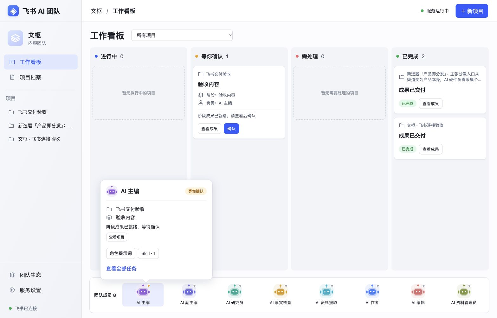
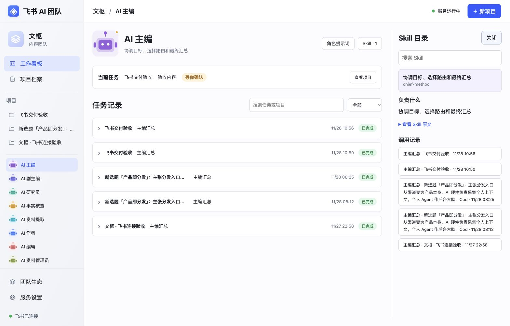
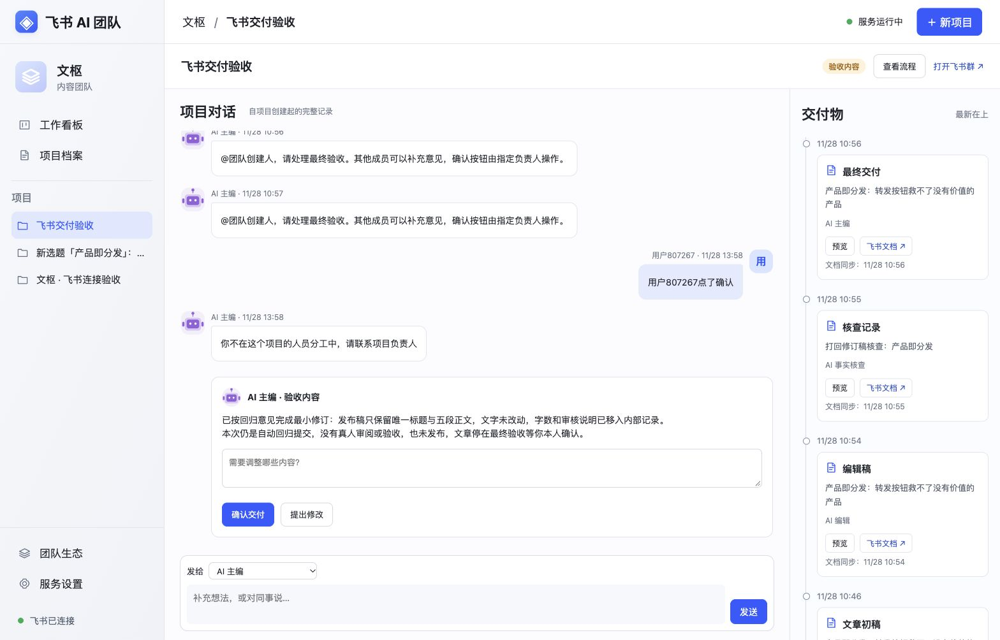
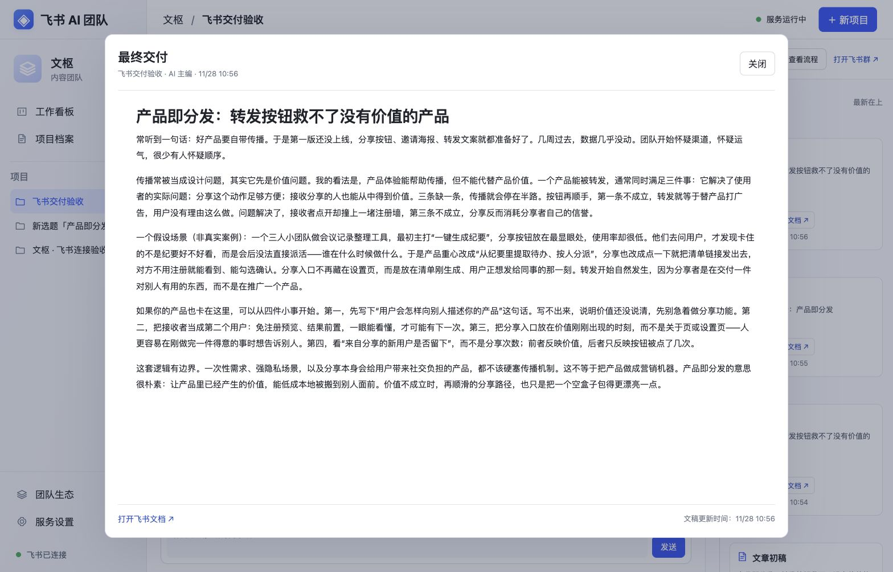

# 工作台 V2 · 本地实现记录

2026-11-28。依据已确认的 [V2 原型](README.md)实现，入口为 `http://127.0.0.1:4870/teams`。页面读取现有项目、角色状态、消息和产物；没有往正式项目中填充原型示例数据。

## 已完成

| 页面 | 实际行为 |
| --- | --- |
| 首屏看板 | 四列项目状态占据首屏，列内滚动。底部头像单排横滑，三人、五人、八人团队共用布局。 |
| 头像浮窗 | 悬停、聚焦或点击打开；显示角色正在处理的项目、阶段和活动，可进入提示词、Skill 和历史任务。 |
| 角色详情 | 按实际执行次数列出任务；支持搜索和状态筛选，展开摘要、关联产物和相关对话，并跳转到项目的对应对话位置。 |
| 角色提示词 | 阅读、编辑、取消、草稿保留、保存。修改生成新的团队包补丁版本，新项目使用新版，既有项目仍锁定原版本。 |
| Skill 目录 | 展示实际配置的技能、说明、原文和有记录的调用任务；没有调用记录时明确提示。 |
| 项目对话 | 人的消息在右侧，AI 在左侧；不同角色有稳定头像，保留实际发送人。按游标加载完整历史，各项目分别保留输入草稿、接收角色和阅读位置。 |
| 交付物 | 右侧时间线展示中间产物与最终产物，按文件更新时间排列；飞书文档同步时间单列。点击在大阅读窗中预览。 |
| 文稿预览 | Markdown 显示为标题、段落、表格和目录；HTML 隔离预览，JSON 等结构化内容按原格式阅读。 |

流程仍使用既有编排、关口、确认人和动作接口。历史卡片只供阅读；有效操作集中展示在项目当前待办处。

## 本地测试

### 真实数据的页面检查

在本机服务上使用现有筑页、观澜和文枢项目逐项操作：

- 八人团队：头像悬停、点击固定、移入浮窗后操作；主编显示“飞书交付验收 · 验收内容 · 等你确认”。
- 五人、三人团队：角色数量、名称、头像与真实状态一致；旧网页项目仍能通过兼容入口打开。
- 角色页：展开多次任务，读取相应对话、当时的角色提示词与 Skill；“查看完整对话”定位主编开始执行的消息，刷新后保留定位。
- 提示词：关闭再打开保留未保存草稿；恢复原内容后保存提示“内容未变”，没有为正式团队创建测试版本。
- 项目对话：人和 AI 分侧显示；切换项目保留未发出的文字和接收角色；读历史时刷新不抢阅读位置。
- 交付物：实际打开“产品即分发”最终稿，正文以阅读格式呈现，保留现有飞书文档入口。
- 390px 小屏：页面没有整体横向溢出；八个头像可横滑；角色页可读；交付物侧栏可打开和关闭。
- 页面控制台未发现错误。

正式项目没有因本次界面测试发送新需求、确认交付或改变专业提示词；“飞书交付验收”仍停在最终确认。

### 写入与流程操作检查

另用临时目录启动隔离的同一套工作台和接口，配合测试 Agent，不连接飞书、不消耗模型额度：

- 在浏览器中修改提示词并保存，生成 `1.0.1`，重新打开能读到修改；已有项目继续锁定 `1.0.0`。
- 逐页加载 145 条消息，检查总数、唯一游标与“更早记录”结束状态。
- 在输入框发送测试文字，经真实消息接口记录并收到测试 Agent 回复。
- 点击当前确认按钮，从原关口进入后续任务再到最终关口，阶段顺序保持原样。
- 测试结束后停止临时服务并删除临时工作区。

自动测试：`npm test`，**326 项通过，0 失败**。新增测试覆盖不可变包编辑、旧版本保留、编辑冲突、完整消息分页、项目隔离、历史任务映射、HTTP 写入校验，以及失败后重试的真实记录。浏览器检查补充覆盖头像浮窗、草稿、提示词保存、Skill、对话、预览和响应式布局。

## 对抗审查中修正的问题

| 问题 | 处理 |
| --- | --- |
| 失败尝试若混入成功历史，会被既有编排当成完成 | 失败和停止记入独立 `attempts`，成功记录继续使用原 `history`。 |
| 提示词直接覆盖会改变已开工项目 | 生成新的不可变团队包，保留旧包、原工作流与 Skill；过期版本保存被拒绝。 |
| 新保存入口可能提前跳过管理员代操作校验 | 先验证既有管理员令牌，再处理保存；补充 HTTP 用例。 |
| 新消息追加、旧卡片更新可能造成重复或串项目 | 使用记录文件位置作为稳定游标，按项目筛选；卡片更新保留原位置。 |
| 后台刷新可能丢失阅读定位或误报新消息 | 保留目标消息标记，仅实际新增的消息触发提醒，编辑中的表单延后重绘。 |
| 旧网页项目的产物是对象，新团队包是数组 | 兼容旧数据结构；旧项目进入原详情，不伪造逐次任务记录。 |
| 小屏打开交付物后缺少就近退出入口 | 在交付物侧栏内部提供关闭按钮。 |

## 数据说明

- 历史数据没有记录的失败尝试、Skill 调用或作者，不根据模型回复补造；新执行开始留存这些字段。
- 产物预览读取工作区当前保留的文件。任务历史中的产物入口不代表每次执行都有独立文件快照。
- 旧网页项目保留原兼容详情与讨论入口；新团队包项目使用本次项目对话页。
- 此次验证覆盖工作台与既有编排的接入，没有重新触发三套团队的模型生成流程。

## 实际页面

以下均为本机真实数据截图，未添加说明箭头。

[五人团队](local-5-roles.jpg) · [三人团队](local-3-roles.jpg) · [390px 小屏](local-mobile.jpg)
