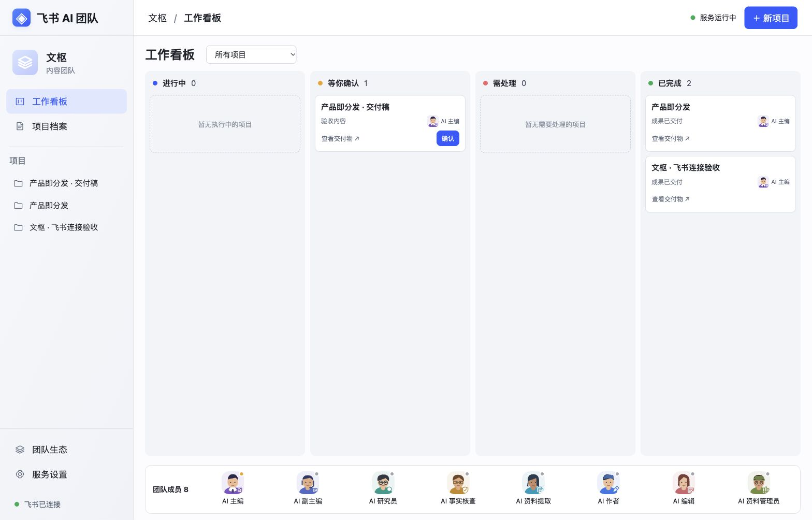
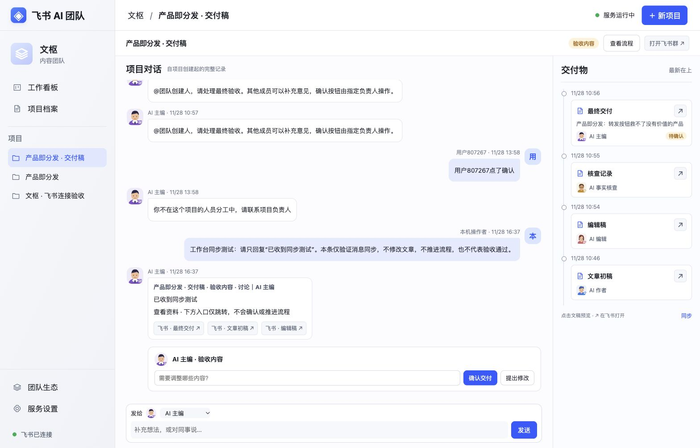
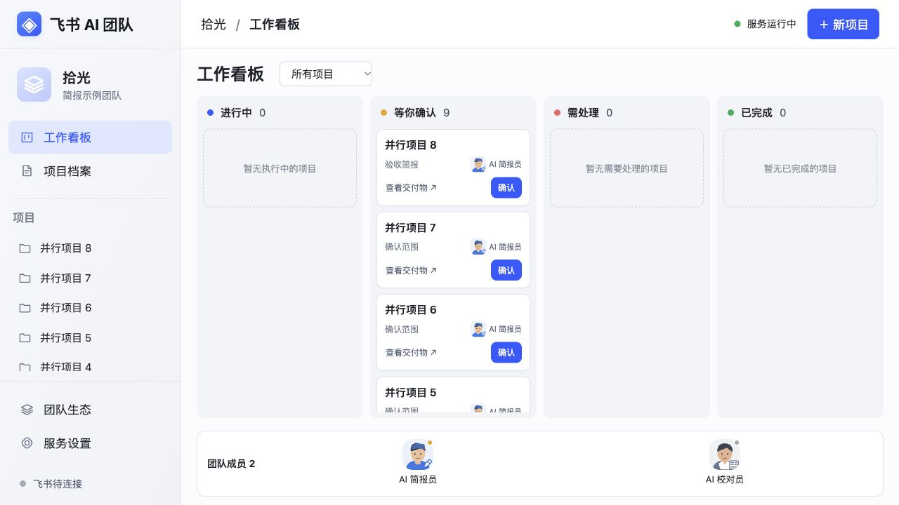

# 工作台紧凑迭代

2026-11-28，本地实现。沿用 V2 四列看板、底部角色栏和项目聊天布局，保留原 workflow。

## 界面调整

- 项目卡保留名称、当前任务、负责人和操作入口，普通等待卡约 110px。1280×720 下每列完整显示 3 项；9 项测试列表在列内滚动，角色栏保持可见。
- 角色使用不同职业插画，发型、配饰和工具均有区别。看板、聊天、角色详情、提示词及交付物作者使用相同头像。
- 头像悬停或聚焦显示任务浮窗；点击直接进入角色详情。Skill、历史任务和提示词编辑入口继续保留。
- 操作按钮使用主色或描边；文档入口使用中性色和 ↗。历史动作显示为记录，不伪装成当前可执行按钮。
- 修改意见改为 34px 高的单行输入框；长内容在输入框内横向查看，也可使用底部对话框。
- 交付物以紧凑时间线展示名称、作者小头像和时间。最新交付显示正文标题及待确认状态，点击名称预览，↗ 打开飞书文档。

截图中的旧权限报错属于修复前的真实历史，保留原记录；最新同步测试位于其后。

## 项目命名

通过项目改名接口将三个现有项目调整为“中国神华投研”“产品即分发”“产品即分发 · 交付稿”，对应飞书群同步为“团队 · 项目”。原需求、交付物、讨论、阶段和会话保留；旧名称写入项目 previousNames。新项目继续沿用主题提取及 24 字名称上限。

## 身份与消息

权限误判来自同一飞书用户的扫码记录和群聊记录拥有不同内部人员编号。现在按可信 union_id、user_id 或同应用 open_id 关联，保留历史编号；跨应用的 open_id 不直接比较。

系统管理员可操作各项目当前关口，普通成员仍按项目分工执行。服务端识别管理员，不接收请求体自报的身份或优先级。管理员明确意见单列在项目上下文中，较新的明确要求优先；消息本身不会自动确认关口。

工作台发送到飞书后只保存一条用户记录，附带真实飞书消息 ID；管理员助手入口使用相同处理。飞书入站按消息 ID 去重。前端由 SSE 通知刷新，定时轮询兜底。

## 验证记录

| 检查 | 结果 |
| --- | --- |
| 自动回归 | `npm test`：330 项通过，0 失败 |
| 管理员权限 | 5 个现有团队包项目的真实身份只读授权检查通过；独立测试覆盖确认、同人旧记录、跨项目权限及伪造身份拒绝 |
| 真实发送和回复 | 在“产品即分发 · 交付稿”发送标注的同步测试；飞书接收原文，AI 主编回复“已收到同步测试”。通过飞书接口回读双方消息 ID 和正文，均匹配，工作台用户记录只有一条 |
| 飞书入站 | 回读“中国神华投研”的已有真人消息，ID 与本地记录一致且只保存一次；重复事件去重另由自动测试覆盖。本轮没有冒充真人生成新的入站消息 |
| 流程 | 真实文章仍在 accept 等待用户；隔离项目点击确认按原流程从确认范围到验收简报 |
| 角色页面 | 头像直达、聚焦浮窗、提示词阅读/编辑/原文保存、Skill 目录、历史任务展开及跳转均可用 |
| 文稿 | 真实最终稿在阅读窗打开；作者头像、飞书外链和时间线可用 |
| 响应式 | 1568×1004 桌面、1280×720 多项目、390×844 手机检查；手机页面无整体横向溢出，交付物侧栏可展开 |

## 对抗检查

- 同名用户、不同应用的同值 open_id、伪造管理员字段不能获得项目操作权限。
- 系统管理员仍需使用当前项目、阶段和卡片；不能用过期卡跳步。
- 两个 HTTP 消息入口都先授权，再发送；机器人转述不再被计成第二条用户对话。
- 改名与其他项目操作使用相同会话锁，避免并发写入错位。
- 独立测试数据和真实项目分开，真实文章最终确认留给用户。

本轮没有新增模型、机器人或 workflow 节点；没有发布文章或推送 GitHub。
