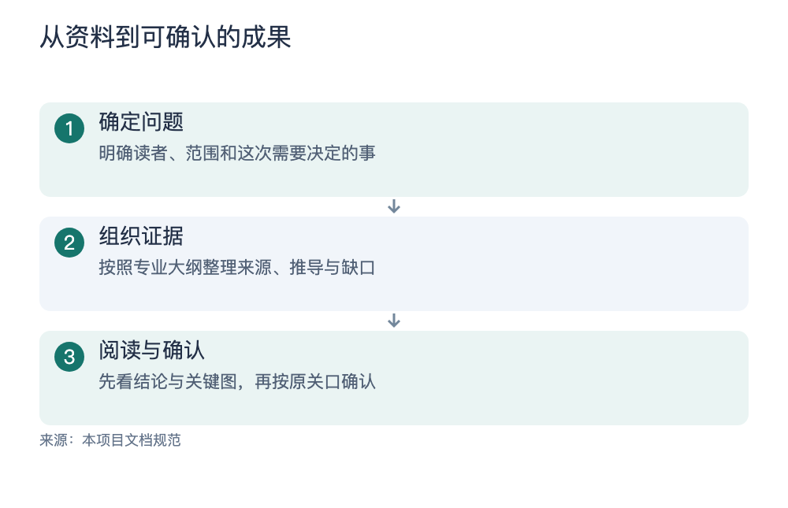
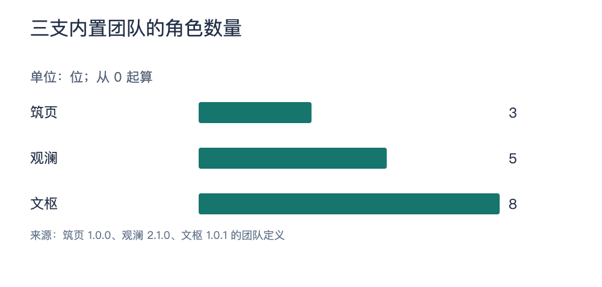

# 让读者看懂一份 AI 团队成果

适用范围：团队包产出的 Markdown 报告与说明；示例日期：2026-11-28。

读者打开文档，首先需要知道这份成果回答什么问题、依据是什么，以及接下来由谁确认。图适合帮助读者看清顺序与差异，正文负责解释原因和限制。以下用本项目的真实规则演示这种组合。

## 1. 先确定问题，再组织证据

开始写作前，先按该角色的专业 Skill 列出大纲。每节明确要回答的问题，再选择材料；涉及步骤关系时，可以把处理顺序画出来。最后仍在项目原有的确认关口交由负责人判断。

图注：图解释阅读与产出的顺序，不新增或替代工作流的确认关口。确定问题、组织证据、阅读与确认依次发生。

来源：本项目《文档与飞书呈现补充规范》。PRD、设计、投研和内容制作继续遵守各自的专业 Skill。

## 2. 用数字说明差异，也说明不能推导什么

内置的筑页、观澜、文枢分别定义了 3、5、8 位角色。这个数字适合说明团队分工的规模，但无法说明哪支团队更好，也不能据此估计模型并发量或内存占用。

图注：各柱从零开始，单位都是“位角色”。图中只比较角色数量，不包含管理员助手。

来源：筑页 1.0.0、观澜 2.1.0、文枢 1.0.1 的团队定义；截至 2026-11-28。角色数量与全局执行并发上限是不同的概念。

## 3. 读者能做什么，由权限和流程共同决定

| 在哪里操作 | 可以做什么 | 是否构成正式确认 |
|---|---|---|
| 飞书文档正文 | 阅读、按项目群权限协作编辑；人的改动保留 | 否；正文改动不自动覆盖本地交付 |
| 飞书文档评论 | 提意见、引用段落；意见回流本项目供后续调用参考 | 否；“通过”“确认”等评论不是审批事件 |
| 项目群或工作台确认卡 | 由有权限的负责人确认、打回或验收 | 是；按当前项目的审核模式执行 |

发布由本团队的协调机器人负责，文档只向项目群授权，不开启互联网公开编辑。权限不足时，工作台显示同步错误；不能把“本地文件已经写好”说成“飞书文档已发布”。

## 4. 阅读这类文档时，检查三件事

1. 标题和章节是否回答了本次问题，专业内容是否完整。
2. 每张图是否有必要、可读、有来源，正文是否解释了图的含义与限制。
3. 需要确认的结论是否仍通过项目关口处理，未解决事项是否清楚保留。

这份示例使用本地确定性图形，不包含真实投研结论或 AI 生成的证据。写作方法参考 W3C 对复杂图形的文字说明建议：重要信息也应能从图旁的正文获得。[W3C 图形说明指南](https://www.w3.org/WAI/tutorials/images/complex/)
