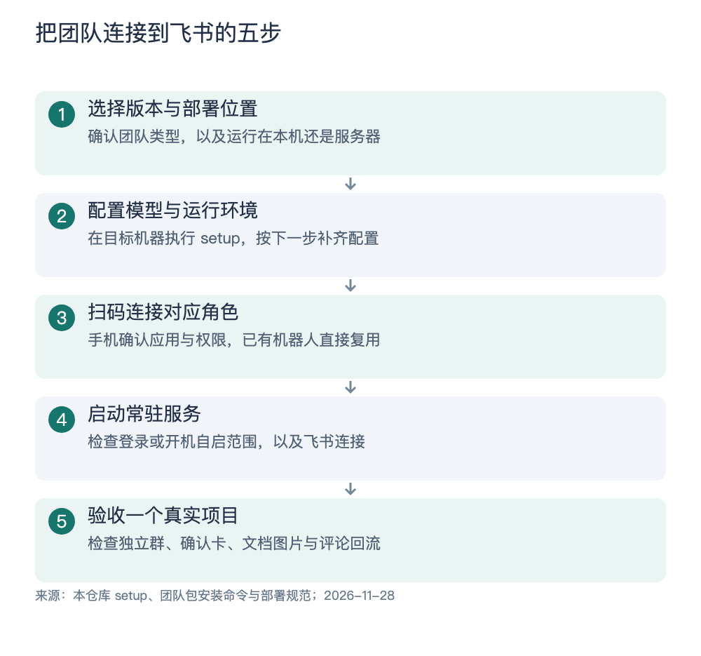

# 把 AI 团队连接到飞书：安装与权限指南

先选择代码运行的机器，再配置模型和机器人。飞书负责收发消息，Agent SDK、项目文件和工作台运行在你选择的本地电脑或服务器上。同一组机器人只由一台机器连接。

图注：已有配置和机器人直接复用。图中是安装顺序，团队内部的工作流由所选团队包定义。

来源：本仓库 `setup.mjs`、团队包安装命令与《部署与常驻》；适用日期：2026-11-28。

## 1. 选版本与部署位置

| 你的需求 | 选择 | 接下来读什么 |
|---|---|---|
| 先搭三位同事，做一个网页 | 启航版 | [启航版提示词](prompts/basic.md) |
| 多个网页项目各有独立群与上下文 | 领航版 | [领航版提示词](prompts/projects.md) |
| 使用投研、内容或其他人分享的团队 | 开放团队包 | [团队包提示词](prompts/ecosystem.md) |

| 服务运行位置 | 准备内容 | 在线条件 |
|---|---|---|
| 本地 macOS | Node.js 24+、Git、网络；执行 `node setup.mjs deploy local` | 当前用户登录后静默启动；休眠、关机或断网会离线 |
| 本地 Linux | 同上，另需 systemd 用户服务与 linger | 启用 linger 后可在无人登录时运行 |
| Linux 服务器 | SSH 地址、账号、端口、登录方式、部署目录 | 在服务器配置并启动；电脑用 SSH 隧道访问工作台 |

Windows 暂无原生常驻安装器。具体命令、远端扫码和迁移步骤见[部署与常驻](部署与常驻.md)，不要同时启动本地和服务器上的同一组机器人。

## 2. 按 setup 的“下一步”完成配置

把所选版本的提示词和 GitHub 链接交给 Coding Agent，让它先读取 `AGENTS.md`。在目标运行目录执行 `node setup.mjs`，按每次输出的“下一步”继续，不另写扫码、建群或服务管理脚本。

模型需要 Anthropic 兼容接口地址、模型名和密钥。密钥只保存到本机 `.env`，不要放进截图、文档、Git 或命令行参数。浏览器用于截图与配图，公开 PDF 阅读需要 Poppler；缺少时由 Coding Agent 根据当前系统检查并安装。

基础安装扫码共四张：产品经理、设计、程序员和管理员助手。扫码时只在飞书手机端确认真实应用名称和权限。开放团队包随后运行 `node scripts/team-pack.mjs init`，在工作台选择团队再扫码：观澜五位、文枢八位，各自使用专属角色。已经创建的机器人不重复创建。二维码会过期，因此本指南不嵌入二维码截图。

## 3. 分清三层权限

应用有 API 权限，不代表任何人都能读文档；能读写文档，也不代表能确认项目。需要分别核对下面三层。

| 权限层 | 用途与配置位置 | 如何判断已生效 |
|---|---|---|
| 机器人应用权限 | 飞书开放平台中开通并发布；新应用按扫码流程申请 | 用实际 API 和入站消息验证，不能只看“已勾选” |
| 文档访问权限 | 协调机器人将对应文档授权给项目群，默认可编辑 | 群成员能打开文档；不设置互联网公开编辑 |
| 项目确认权限 | 平台按项目负责人、原有确认记录与审核模式判断 | 有权限的人可点当前确认卡，评论或普通聊天不代替批准 |

下面列出常见的增补权限，完整基础消息、事件和回调配置仍以标准安装器为准。团队包的文档权限只由协调角色申请，不把密钥传给模型。

| 功能 | 本项目使用的权限 | 缺失时可能看到什么 |
|---|---|---|
| 接收未 @ 的群讨论 | `im:message.group_msg` | 机器人只对 @ 有反应，普通讨论没有入档 |
| 接收私聊、邀请群成员 | `im:message.p2p_msg:readonly`、`im:chat.members:write_only` | 私聊入口无响应或邀请失败 |
| 创建、写入和读取云文档 | `docx:document` | 文档创建、转换或更新失败 |
| 给项目群授权 | `docs:permission.member:create` | 文档已建好，但群成员无法打开 |
| 上传文档内图片 | `docs:document.media:upload` | 文字可能已写入，图片同步报权限不足 |

已有应用补权后需要发布生效，保留原机器人。原网页团队的多项目权限用 `node setup.mjs upgrade-projects`；团队包的文档权限按[文档同步指南](飞书文档同步与反馈.md)处理，不用网页团队的升级命令替其他团队授权。租户管理员审批是否必须，以该租户实际要求为准。[飞书上传素材接口](https://open.feishu.cn/document/server-docs/docs/drive-v1/media/upload_all)

## 4. 用一个真实项目验收

1. `npm run status` 显示常驻服务，工作台能打开，团队机器人连接成功。
2. 通过该团队的协调角色提出短主题和需求，确认开工后出现正确的独立群与工作区。
3. 让团队交付一份简短文档，查看标题、正文、卡片里的 `↗` 入口。需要配图的内容可参照[图文文档示例](examples/图文文档示例.md)。
4. 打开飞书文档，确认图片可见、来源清楚，再留一条明确标注为测试的评论。检查它只回流当前项目，并且没有自动批准项目。
5. 按当前审核模式完成关口，确认工作台与飞书阶段一致。不要把离线替身测试当成真实飞书联调通过。

只看到文字、看不到图时，先看工作台的同步错误。图片权限或网络恢复后，点“同步文档与评论”续传；不要反复重建项目。完整规则见[飞书文档同步与反馈](飞书文档同步与反馈.md)。
