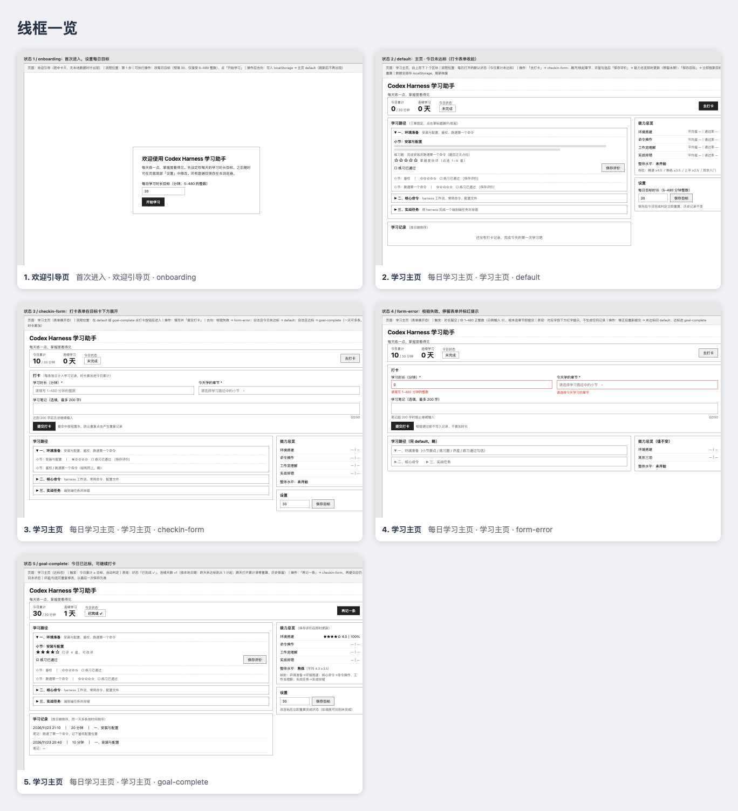
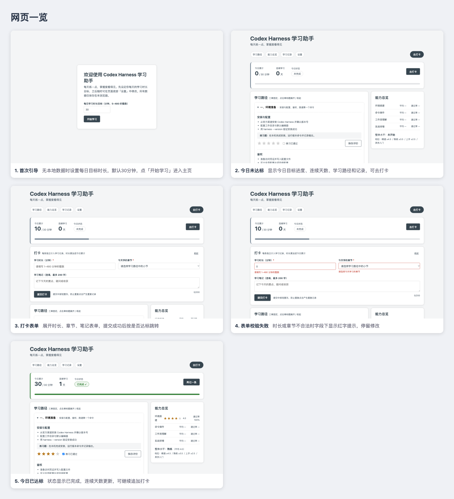

# 实测复盘：照着动手路线做一遍

2026-11-23，我们在一个空目录里照着[动手路线](动手搭建.md)从第 0 步做起，然后在真实飞书群里提了一个需求，一路点卡片到验收。这份复盘记下用了多久、做出来什么样、人要做什么、踩过哪些坑，以及背后是怎么运转的。

| 项 | 这次用的 |
|---|---|
| AI 编程助手 | Codex CLI；每一步开一个新对话，提示词原样照抄 |
| AI 同事的模型 | 豆包 seed-2-1 pro（火山方舟的兼容接口，写在 `.env`） |
| 飞书 | 自己的飞书团队，新建 3 个机器人和一个群 |
| 一句话需求 | "一个督促学习 codex harness 的助手，能够记录个人的学习能力以及学习的效果" |

## 结果

### 搭建：每一步 AI 编程助手干多久

| 步骤 | 用时 | 做完的样子 |
|---|---|---|
| 0 读懂起步包 | 不到 1 分钟 | 准确复述要搭什么、几步、三个角色、四个关口 |
| 1 建 3 个飞书机器人 | 约 3.5 分钟 + 扫码 | `.env` 里 3 组凭证，权限、事件、回调一次填好 |
| 2 接入自检 | 约 3 分钟 | 群里 @ 哪个机器人，哪个就回卡片，点按钮有反应 |
| 3 第一个 Agent | 约 4.5 分钟 | 产品经理调用澄清技能，写出 3 个问题；试跑约 1 分钟 |
| 4 三个角色各跑一次 | 约 13 分钟 | 同一个文件夹里 PRD、线框、主题、网页齐全，交付检查通过 |
| 5 编排 | 约 6 分钟 | 13 项测试：两轮澄清、三个打回、自动走查与回归走查、过期卡片、忙时、出错 |
| 6 串起来跑一遍 | 约 12 分钟 | 真群里从提需求到完成卡片跑通（见下） |
| 7 工作台 | 约 12 分钟 | 看板、项目详情、角色聊天，和飞书群同一套数据；在工作台里点按钮、发消息，群里同步 |
| 8 部署到服务器 | 约 10 分钟 | 一个 Docker 容器，3 个机器人连上飞书，空闲占内存约 95 MB；端口只开在服务器本机，SSH 隧道打开工作台 |

第 4、6 步时间长，是因为 AI 编程助手要真的调用模型，让三个角色把活干一遍来验证。第 1、2 步的时间取自同一天的另一次实测，这次沿用了那次建好的机器人。

### 跑一个需求：AI 同事干多久，人做什么

| 环节 | 谁 | AI 用时 | 人做什么 |
|---|---|---|---|
| 澄清（2 轮） | 产品经理 | 42 秒 + 34 秒 | 每轮在问题卡片里选答案（默认选中推荐项）、提交 |
| 写 PRD | 产品经理 | 2 分 25 秒 | 点"确认 PRD" |
| 线框与主题 | 设计 | 5 分 12 秒 | 看一览图和线框，点"确认设计" |
| 开发网页 | 程序员 | 7 分 21 秒 | — |
| 走查 | 设计（新会话） | 6 分 25 秒 | 看走查结果：9 屏里 1 屏待改，共 4 条问题（1 高 1 中 2 低） |
| 打回、修改 | 程序员 | 3 分 56 秒 | 点"打回"，@AI 程序员 说要改什么 |
| 回归走查 | 设计（新会话） | 3 分 31 秒 | 看结果：上轮问题全部修好，结论"通过" |
| 验收 | 产品经理 | 几秒 | 点"验收通过"，收到完成卡片、网页链接和 `index.html` |

不打回，AI 一共干约 23 分钟；加一轮打回约 31 分钟。人只在 4 个关口出手：回答问题、确认 PRD、确认设计、验收，其余由编排自动接力。

### 做出来什么样

- **PRD**：按 spec-kit 的结构写：产品概述、目标用户与场景、用户故事、页面与状态、边界情况、10 条功能需求、成功标准、假设、本期不做。两轮澄清没问到的，写进"假设"。
- **线框与主题**：5 个状态（首次引导、今日未达标、打卡表单、校验失败、今日已达标），主题选"现代极简"，并写明理由。
- **网页**：一个单文件网页，打卡、学习路径、能力总览、学习记录、设置都能用，数据存在浏览器里。
- **走查**：设计对照 PRD 逐屏检查，查出"能力通过率的分母算错了"这类真问题。打回修改后再查一轮，确认修好。

设计卡片上的线框一览图：



验收卡片上的网页一览图（打回时要求"缩短链路、点击快速跳转"，顶部加了快捷导航）：



## 一次跑通，靠的是三样东西

AI 编程助手每开一个新对话都从零开始，它不知道上一步做了什么，也不知道你心里的标准。起步包就是为这个准备的：

1. **项目说明书（`AGENTS.md`）**：要做什么、整体结构、接口、文件格式、飞书卡片的写法、踩过的坑，都写在一处。每一步的 AI 编程助手读同一份，前后接得上。
2. **角色说明和技能原文（`prompts/`、`team-skills/`）**：澄清、PRD、需求自查来自 GitHub 的 spec-kit，线框、主题、走查、前端来自一套设计工作流。这些是反复调过的提示词，AI 同事照着做，产出才有章法。让 AI 编程助手现写，质量差很多。
3. **施工图（`docs/施工图.md`）**：每个模块放在哪个文件、负责什么、怎么相连、第几步建出来。AI 编程助手照图施工，你照图验收。

再加上**一步一验收**：每段提示词只多一样新东西，出了问题马上知道卡在哪一步。

## 踩过的坑，都已写进说明书

| 坑 | 当时的现象 | 说明书里怎么防 |
|---|---|---|
| 一直运行的程序跟着对话结束被关掉 | 自检程序刚启动就没了 | 要一直运行的程序，你在自己的终端里运行（第 9 节） |
| 角色标识各写各的 | 一步用 `design`，下一步用 `designer`，对不上 | 角色表写死 `product / designer / developer`（第 4 节） |
| 测试里的假智能体比真的宽松 | 测试全过，接上真群就报 `agent.run is not a function` | 假的和真的同一个接口；交付前用真实 Agent 跑到问题卡片（第 4、9 节） |
| 问题卡片的表单写错 | 飞书报 300123"表单里没有提交按钮" | 卡片 2.0 表单的写法逐项写明；先往群里发一张测试卡片（第 7 节） |
| "只有人能让 AI 开工"被照字面理解 | 每一步都要人 @ 才往下走 | 人只在 4 个关口出手，其余编排自动派（第 5 节） |
| 卡片上是英文标识和本机路径 | 进度卡片显示 `product · clarifying` | 给人看的一律中文、相对路径（第 9 节） |
| 点了测试卡片，群里没反应 | 测试卡片和正式卡片长得一样，点了只闪一下"已过期" | 过期点击在群里说一句；测试卡片不带真实项目号（第 7 节） |
| 一览图偶尔有空格 | 机器忙时，后几格还没画完就截了图 | 截图前等各格画完（第 8.1 节） |
| 回归走查漏了用户的意见 | 只核对上一轮的问题，没核对打回时说的"缩短链路" | 回归走查的任务消息带上用户这次的修改意见（第 5 节） |
| 走查说明写成了函数名 | 卡片上出现 `renderGoal 显示 0/30` | 走查说明写用户在页面上看到的（第 5 节） |
| 工作台长得各不一样 | 说明书只写了要有哪些功能，搭出来是浅色的，列的分法也不同 | 第 8.2 节写明长相：配色、看板的列、项目卡、详情三栏、角色聊天、用词 |
| PRD 卡片没有结构图 | 说明书里写的是"可选"，就没做 | 第 8.1 节写成必做，并写明结构图的样子 |
| 国内服务器构建很慢 | 默认的 Debian 源下载很慢 | 提示词 8 写明国内服务器换国内源 |

## 在群里怎么走一遍

- **提需求**：@AI 产品经理，说一句话需求。
- **回答问题**：问题卡片默认选中推荐项，不想细想就直接提交；有补充写在最后一栏。
- **确认或打回**：点"打回"后，按提示 @ 对应的角色说要改什么。验收时打回，程序员会同时处理走查里标了"待改"的屏，改完自动再走查一轮。
- **只点最新的那张卡片**：旧卡片和测试卡片会提示"已过期"或"这是测试卡片"，不会推动流程。
- **等**：一张进度卡片会实时显示它在读写哪个文件。一个环节两三分钟到七八分钟，进度在动就等。

## 两个 AI，各干各的

这套东西里有两种 AI，别搞混：

- **搭建时：AI 编程助手（Codex 或 Claude Code）是施工队。** 它照说明书和施工图把程序写出来、测好。程序跑起来以后，它就不参与了。
- **运行时：3 个 AI 同事用的是 Claude Agent SDK。** 编排每派一次活，就调用一次 SDK 的 `query()`，启动一个 Claude Code 子进程，带上这个角色的说明和技能，只准读写自己的目录。用哪个模型，看 `.env` 里的地址，这次是豆包。

背后是这样一条链：

```
飞书群：@ 机器人 / 点卡片按钮
  → 接入层（src/feishu.mjs）：3 条长连接；只认人发的、@ 了自己的；同一条只处理一次
  → 编排（普通代码，不是 AI）：查阶段表，现在该谁做什么；核对卡片是不是最新的
  → 智能体（Claude Agent SDK → Claude Code 子进程）：带上角色说明和技能干活，边干边报进度
  → 工作区文件：docs/prd.md → design/wireframe.html → site/index.html
  → 交付检查：按文件格式逐项核对，不信 AI 说"做完了"
  → 发卡片：结果、一览图、"打开线框/网页/走查页"链接，需要人的地方放按钮，进入下一关
```

## 遇到问题怎么查

| 现象 | 先看什么 |
|---|---|
| 点了按钮群里没反应 | 是不是点了旧卡片或测试卡片；服务还在不在跑（终端里有"3 个机器人已连上飞书"）；同一个机器人是不是开了两条连接（自检程序没停，或服务器上也在跑） |
| 进度卡片很久不动 | 看最后一行在读写什么。一个环节要几分钟；15 秒没动静会显示"正在思考……" |
| 群里或终端报错 | 报错里带着飞书的 `code` 和 `msg`，原样贴给 AI 编程助手 |
| 一览图有空格 | 点卡片下面的"打开线框""打开网页"看真页面，不影响流程 |
| 说不清哪里不对 | 告诉 AI 编程助手群里发生了什么，让它看 `data/messages/`、`data/state.json` 和服务日志，查出原因再改 |
