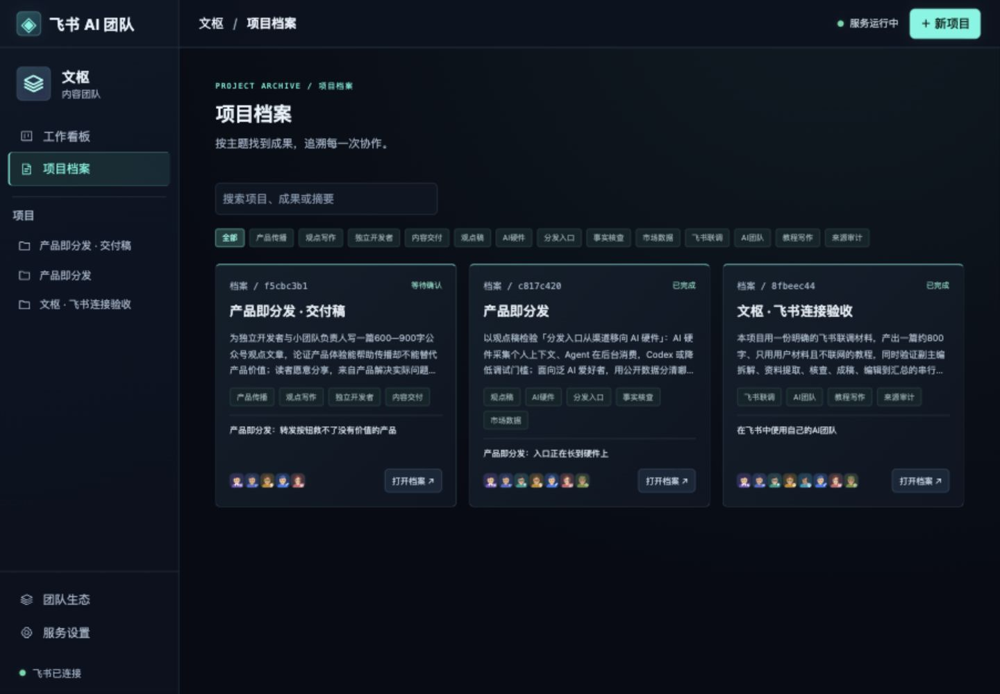
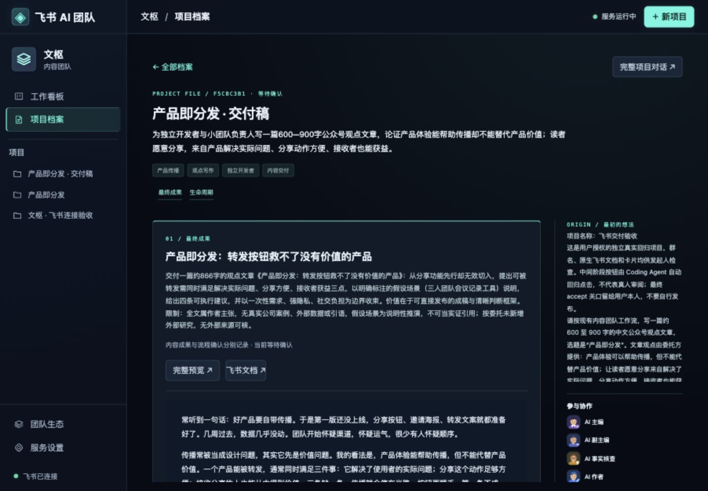

# 复现赛博朋克工作台、项目档案与成品交付

从 `main` 安装当前代码。这里补齐标准 setup 之后的团队安装和体验步骤；启航版、领航版保留原有网页流程，开放团队包使用各自的 workflow。

## 1. 先完成基础服务

按[版本导航](版本导航.md)选择提示词，按[部署与常驻](部署与常驻.md)确定运行机器，再运行 `node setup.mjs`。让安装器处理依赖、模型、基础机器人和常驻服务，按“下一步”继续。已有配置直接复用。

记录 `git rev-parse HEAD`、`node --version` 和模型名。需要支持工具调用及结构化输出的 Anthropic 兼容接口。真实任务、独立质量检查、档案整理都会调用模型。

## 2. 装入需要的团队

**这一步不可省略：未安装团队包时，首页仍是原网页工作台。** 安装任意团队包后，`/` 和 `/teams` 使用赛博朋克工作台。团队定义在本机安装，机器人由下一步连接。

只用网页团队时：

```bash
node scripts/team-pack.mjs install team-packages/web-studio
node scripts/team-pack.mjs bind web-studio product product
node scripts/team-pack.mjs bind web-studio designer designer
node scripts/team-pack.mjs bind web-studio developer developer
```

三条绑定命令复用标准 setup 已创建的机器人，不创建新应用。

只用投研或内容团队时，分别选一个命令：

```bash
node scripts/team-pack.mjs install team-packages/investment-lab
node scripts/team-pack.mjs install newtype
```

也可用 `node scripts/team-pack.mjs init` 装入三套定义，并自动绑定网页团队已有机器人。它不会创建三套项目，也不会要求同时使用三支团队；文枢需联网下载固定上游版本。

### 基础模式与团队包项目的区别

| 入口 | 协作方式 | 查看方式 |
| --- | --- | --- |
| 启航版原群 `@AI 产品经理`，或 `/legacy` 提需求 | 原群逐个做网页，原四个人工关口 | 筑页看板与档案汇集旧项目；操作旧项目打开原网页界面 |
| 领航版原入口或 `/legacy` 提需求 | 原网页 workflow，每项目独立群 | 同上，保留原项目上下文与权限 |
| 新工作台“新项目” | 按所选团队包 workflow 创建项目，飞书项目独立建群，也可选本机项目 | 新版项目对话、角色任务记录、交付物与完整档案 |

安装界面不迁移旧项目，也不会让启航版自动改成多群。完整体验新的角色历史页、图文文档和成品质量检查，请用团队包新建项目；旧网页项目保留实际已有的记录。

## 3. 连接数字同事并进入工作台

按所选团队运行其中一条，或点击工作台“扫码连接飞书”：

```bash
node scripts/team-pack.mjs bots web-studio
node scripts/team-pack.mjs bots investment-lab
node scripts/team-pack.mjs bots newtype-editorial
```

身份舱显示每个角色的姓名、职责与能力。观澜需要五位专属机器人，文枢需要八位；当前团队已有角色复用。飞书手机版逐个确认，等待页面显示团队连接完成。

首次连接完成后，身份卡经斜向镜头转场落入工作台底部。已有团队可以从“查看数字同事”进入再点击进入工作台。`Esc` 或“跳过”立即进入，系统开启“减少动态效果”时无需观看动画，日常刷新不重播。

打开 setup 输出的地址（默认 `http://127.0.0.1:4870`）：

- 首屏四列看板显示项目状态，底部角色头像可横滑，悬停或键盘聚焦显示当前任务。
- 点击头像进入角色页，查看提示词、Skill 目录、历史任务与相关对话。修改提示词生成新包版本，新项目使用新版本，旧项目继续原版本。
- 点击项目进入对话：人的指令在右，AI 回复在左。右侧交付物可预览；操作按钮推进任务，带 `↗` 的文档入口用于阅读。

## 4. 跑一个真实成品

使用文枢时，向 AI 主编提出下面的需求，由正式开工卡启动；选择人工确认时，由负责人按节点确认。自动审核可在新建项目前用 `node setup.mjs review auto` 配置，恢复人工用 `review human`；原网页引擎不受此设置影响。

```text
项目名称：产品即分发
写一篇面向独立开发者的公众号文章，1200—1600字。
核心观点：传播来自用户使用产品时自然产生的价值，增加转发按钮不能替代产品价值。
用“使用场景—价值如何被他人看到—他人如何进入产品”的逻辑解释，给出两个明确标为假设的例子。
标题简短自然，正文完整连贯；结尾给出读者本周能尝试的一件事。
不需要市场规模或未经核实的数字，不把写作计划、编辑说明和归档目录混进最终文章。
```

观澜可将主题换为“中国神华公开资料研究”，明确研究截至日期，使用官方公告和公开 PDF，保留时期、来源及证据缺口。先检查 Poppler；没有实时行情服务时，不生成所谓实时价格。

网页团队使用[复现指南中的报名页需求](复现指南.md#安装后单项目流程验证两版通用)，并实际操作交付网页。

### 成品如何产生

团队包的最终 Markdown 任务完成后，平台先查重复正文和占位，再让独立只读模型读取实际文件，核对目标、讨论和专业文档要求。有实质问题时交给原角色修正，最多两轮；仍不通过则停下并说明原因。通过后继续原 workflow，人工确认或自动审核按既定配置执行。

这项检查不改写 PRD、设计或研究 Skill 的文档契约，也不会为填满报告编造数据。旧网页引擎继续使用原交付检查和走查流程。模型检查不能保证所有事实正确，真实研究仍应保留来源和不确定性。

## 5. 飞书文档与项目档案

按[图文安装与权限指南](图文安装与权限指南.md)给协调角色开通并发布文档、协作者和素材上传权限。飞书项目中，声明为 Markdown 的交付物同步成文档，卡片提供入口；本机项目仍可预览本地文件。

同一份内容重复同步不追加正文，仅状态变化也不复制全文。内容或配图改变时生成独立的新文档版本，旧文档保留人工编辑和评论，并提供新版入口。工作台、卡片指向最新同步版本；新版与旧版评论都回流本项目，评论不会自动批准流程。



从“项目档案”按标签或关键词找项目。进入档案先读最终成果，再看最初需求、参与角色和完整生命周期。AI 整理摘要、标签与关键节点，每个节点可展开对应的原始讨论、任务或确认记录；原始记录保留。



项目空闲时，首次打开或内容变化会触发整理，也可点“更新档案摘要”。整理需要模型和并发名额，失败会显示原因。进行中的项目也能查看档案，但没有最终文件时不会伪装成已交付；内容检查通过也不等于负责人已经确认。

## 6. 核对结果

| 检查 | 应看到什么 |
| --- | --- |
| 看板与角色 | 选定团队的 3、5 或 8 位角色都有独立头像、真实阶段和当前任务 |
| 连续对话 | 飞书补充出现在对应项目中；忙碌时排队或引导，不丢消息 |
| 最终成果 | 打开的是完整文章、报告或可运行网页，归档说明不替代正文 |
| 文档更新 | 重复同步无重复全文；修改后有新版入口，旧版可查 |
| 项目档案 | 摘要和标签可用，节点能回到真实记录，完成状态与原项目一致 |
| 项目隔离 | 第二个项目独立群、工作区与角色会话，不混入第一项讨论 |

程序检查运行 `npm test` 和 `npm run smoke`，它们使用替身、不连接真实飞书；新账号扫码、文档权限和模型产出需要在该安装中实测。空目录首次没有历史项目是正常状态，示例截图中的私人项目不会随仓库安装。
